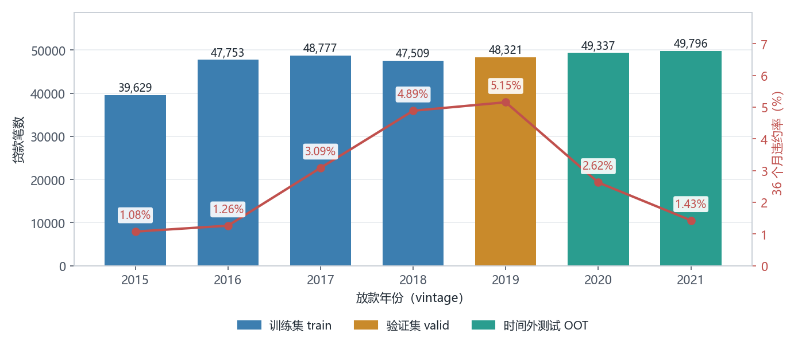
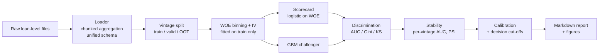
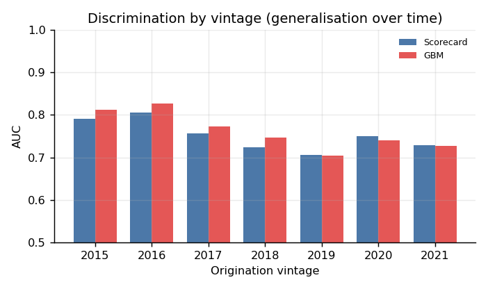

**English** · [简体中文](README.zh-CN.md)

# Credit Default Risk: a PD scorecard on 331,122 real mortgages

[](https://www.python.org/)
[](LICENSE)
[](#tests)

A probability-of-default scorecard on real Freddie Mac loan-level data. Two supervised machine-learning
classifiers are fitted and compared: a WOE-binned logistic scorecard and a gradient-boosted
decision-tree ensemble. Out-of-time validation, origination-time features only, a calibrated PD. The
out-of-time AUC is 0.7462, and the first section below explains why it is not 0.97.

| | |
|---|---|
| **Data** | Freddie Mac Single-Family Loan-Level, 7 vintages (2015–2021) |
| **Scale** | 331,122 loans · **18,696,124** monthly performance records · 2.0 GB of raw text |
| **Out-of-time AUC** | **0.7462** (Gini 0.4924, KS 0.3754) on the 2020–2021 cohort |
| **Models** | L2-regularised logistic scorecard on 14 WOE-transformed variables; histogram gradient-boosted decision trees (depth 4) as challenger |
| **Reproduce in 60 s** | `python scripts/run_pipeline.py`, synthetic data, no download, no licence |
| **Tests** | 10/10, five of them pinned to the real file format |
| **Try it** | [Live demo](https://prui0474.github.io/credit-default-risk/) ([中文](https://prui0474.github.io/credit-default-risk/zh.html)): drag FICO, DTI or LTV and watch the PD move. The scorecard is re-implemented in the browser; the fitted weights travel as an 18 KB JSON. |

## Why the headline number is 0.746 and not 0.97

Loan-default projects on GitHub usually report an AUC around 0.97. Two choices produce that number,
and neither holds up in a model review:

1. **A random train/test split.** The same borrowers and the same economic conditions appear on both
   sides, so the model is tested on the world it was fitted in. With monthly performance data this is
   worse than it sounds: one loan contributes dozens of rows, so a random row split puts the same
   borrower in training and test.
2. **Leaky features.** Fields such as `total_payment`, `recoveries` or current delinquency are only
   known *after* the borrower has stopped paying, so the outcome is baked into the inputs.

This project splits by origination year and drops the fields that are only known after default. What
it reports:

| Question | Where it is answered |
|---|---|
| Can we rank applicants by risk? | AUC, Gini, KS, decile lift |
| Does the ranking survive into later cohorts? | out-of-time split, per-vintage AUC, PSI |
| Is the probability usable for pricing and provisioning? | calibration table (predicted vs realised) |
| What does a cut-off cost? | approval rate vs approved bad rate |
| Which variables carry the signal, and is it plausible? | WOE binning, information value, scorecard coefficients |

## From 18.7M monthly rows to 331,122 loans

Freddie Mac ships two files per vintage, and they are shaped completely differently:

| File | One row = | Rows across 7 vintages |
|---|---|---|
| `sample_orig_YYYY.txt` | one **loan**, with only application-time fields (FICO, DTI, LTV, rate, state…) | 350,000 |
| `sample_perf_YYYY.txt` | one **loan-month**: payment, delinquency, balance, termination | **18,696,124** |

Modelling needs "did this loan ever go bad", not "what happened in month 17". So the 18.7M rows have
to be collapsed, but they cannot be loaded and grouped at once: 18.7M rows × 4 object-dtype
string columns is roughly 3.7 GB in pandas, and reading all 35 columns lands in the 20 GB range.

The loader therefore reduces **while reading**, in two passes:

1. **Within a chunk** (500,000 rows), `groupby('loan_id')` produces four partial summaries:

   | Summary | Aggregation | Why it exists |
   |---|---|---|
   | `min_age` | `min` over all records | was the loan observed from month 0? feeds the data-quality filter |
   | `max_delinq` | `max` inside the 36-month window | worst delinquency → the label |
   | `months_observed` | `max` inside the window | the sort key that makes "last" meaningful |
   | `zb` | `last` inside the window, **after sorting by `months_observed`** | how the loan ended → the label |

2. **Across chunks**, the partials are merged with the matching function: `min` stays `min`, `max`
   stays `max`, and `zb` takes `last` of the rows sorted by `months_observed` (with `na_position="first"`
   so a chunk that saw nothing in the window can never overwrite a real value).

The design rule is that every summary must be **mergeable**: `min`/`max` are order-independent and
merge trivially; `last` is order-dependent, so it has to carry its own sort key. Getting that wrong
does not crash. It silently produces different labels on a second run. This is the same
combiner-then-reducer pattern Spark calls `aggregate` with a `merge` function.

Two filters run on top. Both are counted and printed in the run log:

- **`sample_YYYY` is not the `YYYY` vintage.** ~16% of each file holds loans whose first payment falls
  in YYYY+1. Those rows belong to no configured split.
- **Some loans join the sample late.** Seasoned loans transferred into the portfolio have no reported
  months near origination; labelling them "no default" would fabricate a clean record.

## Split design



Train on 2015–2018, validate on 2019, test on 2020–2021. The test cohort was booked in a different
rate environment, including the 2020 shock. That is the situation a production model faces.

Note the inverted-U: default rates climb from 1.08% (2015) to 5.15% (2019), then fall to 1.43% (2021).
Random splitting would average that away and call it noise.

Four design decisions:

- **Out-of-time split by origination vintage**, never by row.
- **Origination-time features only.** The target is derived from the performance file; the performance
  file is never a feature source. This is what the `schema.py` contract encodes.
- **WOE binning fitted on the training cohort** and then frozen, so validation and OOT data are scored
  through the same mapping, so no information leaks backwards from the future.
- **Two model classes.** A logistic scorecard and a gradient-boosted tree ensemble are fitted on the
  same WOE matrix, so the gap between them measures the model class and nothing else. Specifications
  are in [Method](#method).



## Method

Loan-level binary classification. For loan $i$ the model estimates $PD_i = P(y_i = 1 \mid x_i)$, where
$y_i = 1$ if the loan reaches 90+ days past due inside the 36-month observation window, or terminates
through a credit-event zero-balance code.

**Feature transformation.** Each of the 14 origination variables is cut into at most 10 quantile bins.
Missing values keep a bin of their own, and categorical levels covering under 2% of the book are
pooled into `__OTHER__`. Every bin is then replaced by its weight of evidence, computed with additive
(Laplace) smoothing of 0.5 so that an under-populated bin cannot produce an infinite weight:

$$WOE_b = \ln \frac{P(x \in b \mid y = 1)}{P(x \in b \mid y = 0)}$$

Variables are ranked by information value and read against the usual bands, where below 0.02 is
useless, 0.1 weak, 0.3 medium, and above 0.5 a warning sign rather than a win:

$$IV = \sum_b \left[ P(b \mid y = 1) - P(b \mid y = 0) \right] \cdot WOE_b$$

Bin edges and the WOE map are estimated once on the training cohort and then frozen.

**Model 1, logistic scorecard.** L2-regularised logistic regression (L-BFGS, $C = 1.0$, iteration cap
1,000) on the WOE matrix:

$$\ln \frac{PD}{1 - PD} = \beta_0 + \sum_j \beta_j \, WOE_j$$

Because WOE is ordered in risk, $\exp(\beta_j)$ is the odds multiplier per unit of WOE, which is the
form a credit reviewer can argue with line by line.

**Model 2, gradient-boosted trees.** Histogram gradient boosting: 400 iterations, learning rate 0.04,
tree depth 4, L2 penalty 1.0, early stopping on a 15% internal split with 30 rounds of patience. This
is the decision-tree family, an additive ensemble of shallow regression trees in which each round fits
the gradient of the log-loss left by the previous one. It is fitted on the same 14 WOE columns, so both
models see an identical design matrix.

**Evaluation protocol.** Discrimination by AUC, Gini ($2 \cdot AUC - 1$) and the Kolmogorov-Smirnov
statistic $\max |F_{bad} - F_{good}|$. Stability by PSI on the score and on every WOE variable over 10
quantile bins (below 0.10 stable, 0.10 to 0.25 monitor, above 0.25 shifted), plus AUC recomputed
vintage by vintage. Calibration by predicted against realised rate over probability deciles. And a
decision layer that turns a PD cut-off into approval rate, approved bad rate and the share of defaults
sitting in the rejected segment.

## Results

Measured on the real Freddie Mac cohorts: 183,668 training loans, 48,321 validation, 99,133
out-of-time.

| Model | Split | n | Bad rate | AUC | Gini | KS |
|---|---|---|---|---|---|---|
| Scorecard | train | 183,668 | 2.64% | 0.7805 | 0.5611 | 0.4187 |
| Scorecard | valid | 48,321 | 5.15% | 0.7050 | 0.4100 | 0.3025 |
| **Scorecard** | **OOT** | **99,133** | **2.02%** | **0.7462** | **0.4924** | **0.3754** |
| GBM | train | 183,668 | 2.64% | 0.7993 | 0.5985 | 0.4514 |
| GBM | valid | 48,321 | 5.15% | 0.7040 | 0.4080 | 0.3021 |
| GBM | **OOT** | 99,133 | 2.02% | 0.7381 | 0.4762 | 0.3542 |



Three things in that table:

- **The GBM wins in-sample and loses out-of-time.** 0.7993 vs 0.7805 on the training cohort, then
  0.7381 vs 0.7462 on the 2020–21 cohort. That 0.061 AUC swing is the reason the scorecard ships.
- **Validation is not a smaller test set.** The 2019 cohort scores 0.7050, the 2020–21 cohort 0.7462.
  Had validation been the final answer, the honest number would have looked worse than it is. That
  is why the OOT cohort stays sealed instead of being tuned against.
- **Ranking holds, calibration does not.** On the scorecard, decile default rates run from 6.84% to
  0.33%, and the top decile captures 33.8% of all defaults (lift 3.38). But predicted PD under-shoots
  the realised rate in **all ten** bands. The model is a ranking tool; it cannot be used to price a
  loan or compute expected loss without recalibration.

Feature stability is reported per variable: `orig_rate` (PSI 2.60) and `dti` (0.32) have shifted
between the training and OOT populations, which is what you would expect across a rate cycle. It is
also why per-vintage AUC is inspected instead of a single pooled number.

## What this model does not do

- **Reject inference.** The training book only contains approved loans, so the model is blind to the
  applicants who were previously declined. Fixing this needs declined-application data or a
  parceling / bivariate-probit setup.
- **Survival modelling.** A binary 90+ DPD flag throws away *when* the default happened. A Cox or
  discrete-time hazard model would use that, and would handle un-matured cohorts correctly.
- **Fairness testing.** Protected attributes are absent from these datasets; proxy analysis on
  geography is indicative, not conclusive.
- **Profit.** AUC and KS measure ranking, not money. Cutting a loan book needs rate, loss-given-default
  and prepayment assumptions.

## Data sources

All three sources below are public, loan-level, and carry a hard outcome label.

| Source | Coverage | Access | Default label | Why it is here |
|---|---|---|---|---|
| **Freddie Mac Single-Family Loan-Level** | 1999 → current quarter (~55M mortgages) | Free registration, non-commercial | 90+ days past due, or a credit-event zero-balance code | Full origination risk drivers plus monthly performance history. The primary path. |
| **SBA 7(a) / 504 FOIA** | FY1991 → current quarter | Free, no registration, plain CSV | `loanstatus == 'CHGOFF'` | A contrast case: real money movement, but no bureau score, DTI or collateral. Shows how much of the discrimination comes from the missing data rather than the model. |
| **Synthetic smoke test** | Built in | None | Generated | Lets anyone reproduce the whole pipeline in seconds, on a laptop, with no licence. Clearly labelled as illustrative. |

> The 2018-and-earlier datasets that dominate tutorials (LendingClub, Home Credit, the UCI Taiwan card
> table) are not used here: a model fitted on a pre-2018 credit cycle says little about the portfolio
> a bank is booking today. Freddie Mac and SBA keep appending new vintages, which is what makes the
> stability analysis meaningful.

## Quick start: 60 seconds, no data download

```bash
git clone https://github.com/prui0474/credit-default-risk.git
cd credit-default-risk

python -m venv .venv
.venv\Scripts\activate          # Windows
# source .venv/bin/activate     # macOS / Linux

pip install -r requirements.txt
python scripts/run_pipeline.py
```

The default `data.source` is the synthetic smoke test, so you get figures, a markdown report under
`reports/`, and a one-line metric summary without registering anywhere. Those numbers are illustrative
and are **not** the results table above.

```bash
python tests/test_pipeline.py   # 10/10, no pytest needed
```

## Plug in the real data

**Option A: Freddie Mac (recommended).** Register for free at Clarity Data Intelligence. The
download portal lives at <https://claritydownload.fmapps.freddiemac.com/CRT/>. After signing in, open
the **SFLLD Data** tab (not *CRT Data*, which is a different dataset). Download the *sample* files
(50,000 loans per vintage year, small enough for a laptop), unzip them under `data/raw/freddie/`, then:

```bash
python scripts/run_pipeline.py --source freddie
```

**Option B: SBA (no registration).** Download the 7(a)/504 FOIA CSVs from
<https://data.sba.gov/dataset/7-a-504-foia>, put them under `data/raw/sba/`, list them in
`config.json`, then:

```bash
python scripts/run_pipeline.py --source sba
```

A step-by-step walk-through (registration, unzipping, what you should see at each stage) is in
[`docs/guide-zh.md`](docs/guide-zh.md).

### Four quirks in the real files

All four were checked against the files served in October 2026 (`sample_2015` … `sample_2021`):

- **The published layout is out of date.** `file_layout.xlsx` documents 32 fields per file; the served
  sample files carry **31** (origination) and **35** (performance). The origination file has dropped
  the published field 25, and the performance file appends three columns. Every field the model uses
  sits at the same *position* in both layouts, so the loader selects **by position, never by name**,
  and pattern-checks the join key, so a future reshuffle fails loudly instead of silently
  mis-labelling defaults.
- **`sample_YYYY` is not the `YYYY` vintage.** About 16% of each file holds loans whose first payment
  falls in YYYY+1. Vintage is defined by *first payment date*, and rows outside the configured
  vintages are dropped and counted in the run log instead of being silently discarded by the splitter.
- **Some loans join the sample late.** See above. Dropped and counted too. Look for
  `dropped(no_opening_window=…, outside_split_vintages=…)` on the `[data]` line.
- **The 2020–2021 shock dominates the vintages around it.** Any vintage whose 36-month window touches
  2020–2021 inherits the COVID delinquency spike. That is why the 2017–2019 vintages default several
  times more often than 2015–2016 and 2021, and it is what makes the out-of-time split genuinely hard
  rather than a formality.

## Repository layout

```
credit-default-risk/
├── README.md                # this file (English)
├── README.zh-CN.md          # Chinese version, rewritten rather than translated word for word
├── config.json              # data source, split cohorts, model params
├── src/cdr/
│   ├── schema.py            # the column contract every loader must satisfy
│   ├── config.py            # config + path resolution
│   ├── data/                # loaders: freddie (chunked), sba, demo (synthetic)
│   ├── features.py          # WOE binning, IV, frozen-mapping encoder
│   ├── split.py             # vintage-based OOT split, random split for contrast
│   ├── models.py            # scorecard + gradient boosting
│   ├── evaluate.py          # AUC/Gini/KS, PSI, decile lift, calibration, cut-offs
│   ├── report.py            # figures + markdown report
│   └── pipeline.py          # load -> split -> WOE -> model -> evaluate -> report
├── scripts/
│   ├── run_pipeline.py      # CLI entry point
│   └── build_manual_figures.py  # regenerates every figure in the Chinese handbook
├── tests/test_pipeline.py   # 10 smoke tests, runnable without pytest
├── reports/                 # generated report and figures (git-ignored)
└── docs/
    ├── index.html           # static demo: the scorecard re-implemented in the browser
    ├── zh.html              # same page in Chinese
    ├── demo/scorecard.json  # bin edges, WOE maps and coefficients exported for that page
    ├── 项目全景与知识点手册.md  # full walkthrough handbook (Chinese, 11 chapters, figures)
    ├── guide-zh.md          # step-by-step data guide (Chinese)
    ├── figures/             # 16 figures: pipeline, leakage, WOE, ROC, vintage decay
    └── refs/                # official field layout definitions
```

## Tests

```bash
python tests/test_pipeline.py
```

Covers: schema completeness, no vintage overlap between splits, WOE handling of unseen categories and
missing values, metric sanity (a perfectly ordered score gives AUC 1.0, PSI marks a shifted
distribution), end-to-end pipeline on synthetic data, and five loader tests pinned to the real file
format, including a regression test for the layout drift (the published layout says 32/32 columns,
the files actually ship 31/35), a guard that a too-narrow file is rejected rather than silently
mis-parsed, and the two data-quality filters (unobserved opening window, out-of-scope vintages).

## References

- Siddiqi, N. (2017). *Intelligent Credit Scoring: Building and Implementing Better Credit Risk
  Scorecards* (2nd ed.). Wiley.
- Thomas, L. C., Edelman, D. B., & Crook, J. N. (2017). *Credit Scoring and Its Applications* (2nd
  ed.). SIAM.
- Lessmann, S., Baesens, B., Seow, H.-V., & Thomas, L. C. (2015). Benchmarking state-of-the-art
  classification algorithms for credit scoring: An update of research. *European Journal of
  Operational Research*, 247(1), 124–136.
- Hand, D. J., & Henley, W. E. (1997). Statistical classification methods in consumer credit scoring:
  a review. *Journal of the Royal Statistical Society: Series A*, 160(3), 523–541.

## Licence and data attribution

Code: MIT (see `LICENSE`).

Data is **not** redistributed here. Freddie Mac's Single-Family Loan-Level Dataset is free for
non-commercial, academic and research use subject to its own terms and requires a licensing agreement
for commercial redistribution. Attribute it as *Freddie Mac, "Single Family Loan-Level Dataset", with
the retrieval date and vintage range*. SBA 7(a)/504 FOIA data is US government public domain.
