# 项目全景与知识点手册

> **credit-default-risk —— 用真实房贷数据做违约风险建模**
>
> 这份手册面向「没参与开发、但需要能讲清楚这个项目」的人。
> 目标不是让你会写代码，而是让你看到报告里任何一个数字，都能说出
> **它是什么、为什么这么算、不这么算会怎样**。

---

## 0. 怎么用这份手册

| 你有多少时间 | 怎么读 |
|---|---|
| **5 分钟** | 只读下面的「一句话总结」+ 第 0 章 + 第 10 章的简历 bullet |
| **30 分钟** | 读第 0–2 章 + 第 7 章（业务、数据、标签、指标）——这四章覆盖 80% 的面试问题 |
| **2 小时** | 全部顺序读一遍，跟着每章的「为什么」自己回答一遍 |
| **面试前 10 分钟** | 附录 A 术语表 + 附录 D 结果总表 + 第 10 章问答清单 |
| **完全没学过 ML** | **先读 [第 4.5 章](#第-45-章--给零基础读者的-ml-最小知识)**，再回头从第 0 章顺序读。这一章用图解释「模型是什么、训练在干什么、决策树/随机森林/GBM 什么关系」，不需要任何 ML 基础 |

### 一句话总结

> 用 33 万笔美国真实房贷（2015–2021 共 7 个放款年份），训练一个能输出「这笔贷款将来违约概率」的模型。
> 做法是先把「违约」定义成「36 个月内逾期 90 天以上」，只用放款当时就知道的信息做特征，
> 按放款年份切出时间外测试集，再用**评分卡（可解释）**和**梯度提升（性能上限）**两个模型对比。
> 时间外 AUC **0.746**、Gini **0.492**、KS **0.375**；最差档位坏账率 6.32%、最好档 0.26%，相差约 24 倍。

### 目录

| 章节 | 内容 |
|---|---|
| [第 0 章](#第-0-章--业务问题银行到底在算什么数) | 业务问题：银行到底在算什么数 |
| [第 1 章](#第-1-章--数据从哪来长什么样) | 数据：从哪来、长什么样 |
| [第 2 章](#第-2-章--标签什么算违约) | 标签：什么算「违约」 |
| [第 3 章](#第-3-章--防数据泄漏为什么只能用放款时的信息) | 防数据泄漏 |
| [第 4 章](#第-4-章--时间外检验为什么不能随机切数据) | 时间外检验 |
| [第 4.5 章](#第-45-章--给零基础读者的-ml-最小知识) | **给零基础读者的 ML 最小知识**（含决策树 → 随机森林 → GBM） |
| [第 5 章](#第-5-章--特征工程分箱woeiv) | 特征工程：分箱、WOE、IV |
| [第 6 章](#第-6-章--模型评分卡-vs-梯度提升) | 模型：评分卡 vs 梯度提升 |
| [第 7 章](#第-7-章--评估五个指标各回答什么问题) | 评估：五个指标 |
| [第 8 章](#第-8-章--决策层从概率到业务动作) | 决策层 |
| [第 9 章](#第-9-章--踩坑复盘四个跑得通但是错) | 踩坑复盘 |
| [第 10 章](#第-10-章--怎么讲出来star-与面试问答) | 怎么讲出来：STAR 与问答 |
| [附录 A–D](#附录-a--术语表) | 术语表 / 文件地图 / 常用命令 / 结果总表 |

---

## 第 0 章 · 业务问题：银行到底在算什么数

银行放出去的每一笔贷款，都可能收不回来。所以放款前必须先算一个数：

> **这笔贷款将来不还钱的概率有多大？**

这个数有专业名字：**PD（Probability of Default，违约概率）**，取值 0 到 1。它直接决定三件事：

| 用途 | 怎么用 PD |
|---|---|
| **放不放款** | PD 超过某个阈值就拒绝 |
| **收多少利息** | PD 高就加价，用利息收入覆盖预期损失 |
| **留多少钱做坏账准备** | 监管叫「拨备」（provision），按 PD × 损失程度 × 敞口 计提 |

我们的模型干的事就是：**输入一笔贷款的原始信息（信用分、首付比例、收入负债比……），输出一个 PD 数字。**

整个项目的五步流程如下——**你现在看到的每一张图、每一个数字，都是这条链上某一步的产物**：

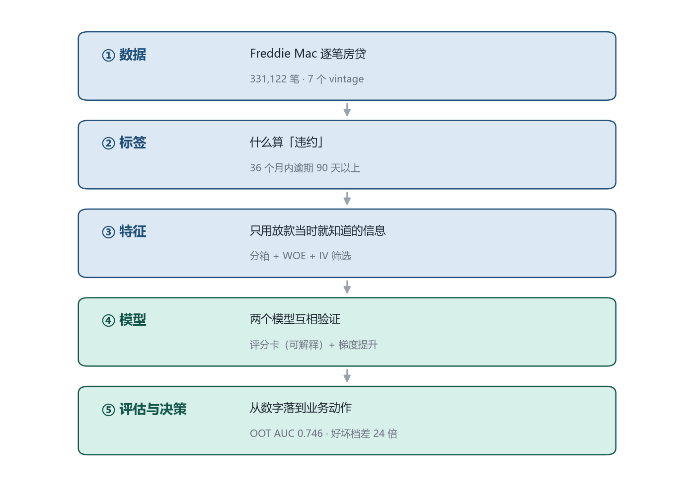

**为什么这件事值得写进简历**：信贷风险建模是银行零售风险部门（Risk Management / Credit Analytics）的日常核心工作，香港每家银行都在做，而房贷是香港银行最大的风险敞口。数据科学 + 金融方向的背景与这类岗位是天然对口的。

---

## 第 1 章 · 数据：从哪来、长什么样

### 1.1 数据来源

**Freddie Mac（弗雷迪麦克）**，美国两大住房抵押贷款机构之一。它依法公开**每一笔**房贷的放款信息和逐月还款记录，免费供学术与非商业使用。

> **为什么不用 Kaggle 上那些「信贷违约」数据集？**
> LendingClub 止于 2018Q4、Home Credit 是 2018 年竞赛数据、UCI 台湾信用卡是 2005 年的、Give Me Some Credit 是 2011 年的——全都停更近十年，教程味重、面试官见得多。
> Freddie Mac 的官方数据一直更新到 **2026 年一季度**，而且**是真正的银行按揭数据**。

### 1.2 两份文件必须配对使用

这是行业里最基础的两种表结构：

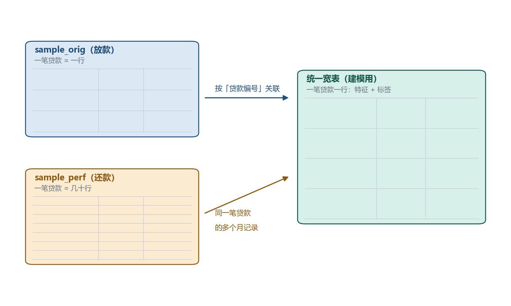

| 文件 | 里面装什么 | **一行代表什么** | 本次数量 |
|---|---|---|---|
| `sample_orig_YYYY.txt`（放款） | 放款**那一刻**的信息：信用分、贷款额、利率、首付比例、收入负债比、房子在哪个州、自住还是投资…… | **一笔贷款** | 35 万行（7 年 × 5 万笔） |
| `sample_perf_YYYY.txt`（还款） | 放款**之后**每个月的状态：还欠多少、当前逾期几个月、是否已结清 | **一笔贷款 × 一个月** | **1,870 万行** |

- **存量表**（一笔一行）+ **流水表**（一笔多行），按「贷款编号」关联（join）成一张宽表。
- 那个 1,870 万行，就是为什么程序必须**分块读**（chunk）：一次性读进内存会直接把笔记本撑爆。

### 1.3 核心概念：vintage（放款批次）

> 我们不管「现在是什么时候」，而是按**这笔贷款是哪一年放出去的**分组。
> 2015 年放的那一批叫 2015 vintage。

这是信用风险里最重要的概念，第 4 章的时间外检验完全建立在它上面。

### 1.4 字段位置表（程序实际读的列）

官方说明书是 32 列，但实际文件是 **31 列 / 35 列**（第 9 章解释为什么）。以下是程序实际使用的位置（**1-based 序号**）。

**放款文件 `sample_orig`**

| 第几列 | 字段 | 程序里叫什么 | 用途 |
|---|---|---|---|
| 1 | Credit Score 信用分 | `fico` | 特征 |
| 2 | First Payment Date 首次还款日 | — | **决定 vintage** |
| 6 | MI % 房贷保险覆盖率 | `mi_pct` | 特征 |
| 8 | Occupancy 自住/投资/度假 | `occupancy` | 特征 |
| 9 | CLTV 合并贷款价值比 | `cltv` | 特征 |
| 10 | DTI 收入负债比 | `dti` | 特征 |
| 11 | Original UPB 原始贷款额 | `orig_upb` | 特征 |
| 12 | LTV 贷款价值比 | `ltv` | 特征 |
| 13 | Original Interest Rate 原始利率 | `orig_rate` | 特征 |
| 14 | Channel 获客渠道 | `channel` | 特征 |
| 17 | Property State 所在州 | `state` | 特征 |
| 18 | Property Type 房屋类型 | `property_type` | 特征 |
| **20** | **Loan Sequence Number** | **`loan_id`** | **主键 / 关联键** |
| 21 | Loan Purpose 贷款用途 | `loan_purpose` | 特征 |
| 22 | Original Loan Term 期限（月） | `term_months` | 特征 |
| 23 | Number of Borrowers 借款人数 | `num_borrowers` | 特征 |

**还款文件 `sample_perf`**

| 第几列 | 字段 | 用途 |
|---|---|---|
| **1** | **Loan Sequence Number** | **关联键** |
| 4 | Current Loan Delinquency Status 当前逾期月数 | **造标签**（≥3 即 90+ 天） |
| 5 | Loan Age 账龄（第几个月） | 判断观察窗口 / 观测完整性 |
| 9 | Zero Balance Code 零余额码 | **造标签**（02/03/09/96 = 信用事件） |

### 1.5 本次数据的真实规模

| 项目 | 数值 |
|---|---|
| 下载文件 | `sample_2015` … `sample_2021`，共 7 组 14 个 txt |
| 放款记录合计 | 350,000 笔 |
| 还款记录合计 | 18,696,124 行 |
| **清洗后进入建模** | **331,122 笔** |
| 剔除：观测窗口不完整 | 10,922 笔 |
| 剔除：放款年份超出 2015–2021 | 7,956 笔 |

---

## 第 2 章 · 标签：什么算「违约」

### 2.1 一个反直觉的事实：这张表里没有「违约」这一列

打开 Freddie Mac 的原始文件，你会看到 60 多个字段：FICO 分数、贷款金额、利率、州、房型……**但找不到一个字段叫 `default` 或 `is_bad`。**

因为「违约」不是数据，是**定义**。同一笔贷款，用不同定义会得出不同标签：

| 定义 | 结果 |
|---|---|
| 只要晚还过一天就算违约 | 违约率极高，模型学到的是「谁会偶尔手头紧」 |
| 逾期 30 天以上 | 违约率中等 |
| **逾期 90 天以上**（业界标准） | 违约率低，但确实代表「收不回来了」 |
| 只有被法拍才算 | 违约率极低，样本太少，模型学不动 |

银行业和巴塞尔协议通行的是**90 天以上逾期（90+ DPD, Days Past Due）**。它对应一个现实判断：一个人连续三个月一分钱不还，基本可以认为他不打算还了。所以本项目的标签定义为：

> **`ever_90dpd_within_36m`** —— 放款后 **36 个月内**，只要出现过一次「逾期 ≥ 90 天」，或者出现「因信用事件而结清」，就记为违约（1）；否则记为正常（0）。

### 2.2 为什么是 36 个月，而不是 12 或 60

这是一个「看得准」和「等得起」之间的折中：

| 窗口 | 优点 | 缺点 |
|---|---|---|
| 12 个月 | 数据出得快，模型更新勤 | 太多「将来会违约」的贷款还没暴露，被误标成正常 |
| **36 个月** | 房贷违约绝大多数在头 3 年暴露；同时是业界常用口径 | 需要等 3 年才能给一批贷款定标签 |
| 60 个月 | 标签最完整 | 数据滞后 5 年，模型上线即过期 |

在代码里它是 `config.json` 的一个参数：

```json
"target": { "definition": "ever_90dpd_within_36m", "performance_window_months": 36 }
```

改这个数字，整套流程的样本量、违约率、AUC 全都会变——所以它是**写进报告第一句话**的假设。

### 2.3 判定规则：两条，任一命中就算违约

还款记录文件（Monthly Performance）每个月一行，记录这笔贷款「这个月是第几个月（loan_age）、逾期了几个月（delinquency status）」。

```
对每一笔贷款，只看 loan_age ≤ 36 的那些月份：

  规则 A：某月 delinquency_status ≥ 3   →  违约
          （3 表示逾期 3 个月 = 90 天）

  规则 B：某月 zero_balance_code ∈ {02, 03, 09, 96}
          →  违约
          （02=第三方卖房结清 03=短售 09=法拍 96=不良资产处置）

  两条都不满足           →  正常（0）
```

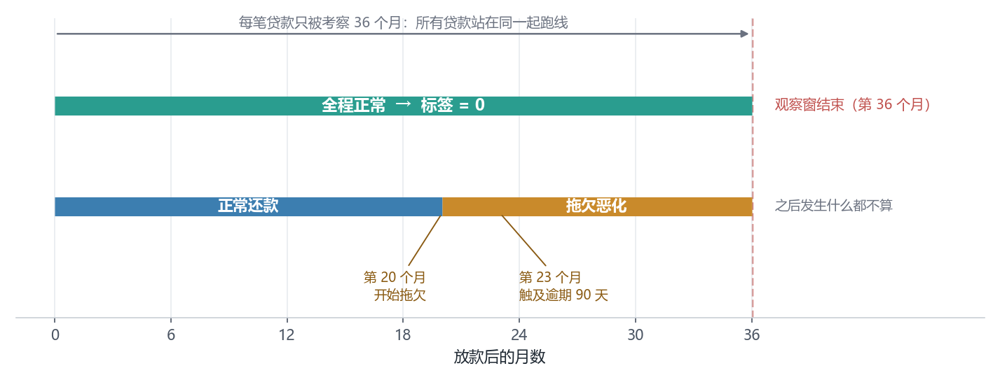

上面这张图是一条贷款的「时间轴」。横轴是账龄（放款后第几个月）。只有落在 **0–36 这个灰色窗口内** 的还款记录才参与定标签；37 个月以后发生的事情，与本次标签无关。

**规则 B 为什么必须加上**：有些贷款逾期还没到 90 天，就被银行直接短售（03）或法拍了（09）。如果只看逾期月数，这些最坏的贷款反而会被标成「正常」——那是把最坏的人当成好人来训练。

> 这里踩过一个坑：一开始怀疑 delinquency 字段里有 `99` 这种「宽限期」特殊编码，会让「≥3 即违约」失效。实际抽查了 2019/2020/2021 三年的还款文件，该字段只有 `00`–`63` 的数值和 `RA`（少量，表示已还清），**没有 99**，所以规则成立。这种「先验证假设再往下走」的动作，写进报告能体现严谨性。

### 2.4 三个容易忽略的陷阱

#### 陷阱一：右删失（Right Censoring）

我们的数据截止到某个时间点。2021 年放款的贷款，到数据截止时可能只走了 20 个月，还没到 36 个月。

- 如果直接把它标成「正常」，等于**替它宣布「它不会违约」**，而实际上它只是**还没到期**。
- 这叫右删失：观察被时间截断了。

处理方式有两种，我们用的是第二种：

| 做法 | 说明 |
|---|---|
| 延长数据下载到 2024 年以后 | 让 2021 vintage 走满 36 个月 |
| **只用「走满 36 个月」的贷款** | 本项目做法：窗口内记录不足的，直接剔除 |

#### 陷阱二：幸存者偏差 / 观测完整性

更隐蔽的一个问题：Freddie Mac 的数据文件是**按年份归档**的，某一年文件里会混进少量下一年才放款的贷款。这些「迟到」的贷款，在数据里可能只有第 44 个月才开始有还款记录——前面 43 个月**根本没被观测到**。

如果不管，它们会被当成「36 个月内没有任何逾期记录」→ 全部标成正常 → 相当于往训练集里塞了一批「我们其实不了解」的好人。

实际规模：最早账龄 ≥ 2 个月的贷款一共 **2,736 笔（5.47%）**，全 7 年合计剔除 **10,922 笔**。

代码里的做法是在 `_read_perf` 里聚合出一个 `min_age`（这笔贷款在数据里最早出现的账龄），然后：

```python
MAX_UNOBSERVED_START_MONTH = 1        # 允许最早从第 0 或第 1 个月开始观测
observed_from_start = df["min_age"].le(MAX_UNOBSERVED_START_MONTH).fillna(False)
df = df[observed_from_start]
```

剔除的数量会写进 `df.attrs`，流水线日志里会打印出来——**任何剔除都必须留下痕迹**，这是可复现性的基本要求。

#### 陷阱三：贷款编号不合法

Freddie Mac 的贷款编号有固定格式：`F` + 两位年份 + `Q` + 季度 + 7 位序号，例如 `F15Q10000001`。

读文件时如果**列错位**，这个字段会读到别的列上去，读出来的就不是这个格式。所以 loader 里加了一道护栏：抽样 500 个编号做正则校验，不符就立刻报错，而不是带着脏数据一路跑到出报告。

```python
LOAN_ID_PATTERN = re.compile(r"^[A-Za-z]\d{2}Q\d+$")
```

> 这道护栏救过一次命——它就是发现「列布局和官方文档不一致」的直接线索（见第 9 章坑 1）。

---

## 第 3 章 · 防数据泄漏：为什么只能用「放款时的信息」

### 3.1 什么是数据泄漏

打个比方：

> 你让学生在考前做模拟卷，但答案就印在卷子背面。他考了 98 分。
> 这个分数不代表他学会了，只代表他会翻背面。

数据泄漏（Data Leakage）就是这个「答案印在背面」。模型训练时如果用到了**放款当下不可能知道的信息**，它在训练集上会漂亮得不像话，一上真实场景立刻崩。

信贷模型里最容易泄漏的字段：

| 字段 | 为什么是答案 |
|---|---|
| 当前逾期月数 | 这是标签本身 |
| 已还期数 / 剩余本金 | 只有「活下来」的贷款才还了那么多期 |
| 结清日期 / 零余额码 | 它直接决定了标签 |
| 损失金额 / 回收金额 | 违约之后才有 |
| 最近一次付款日期 | 越接近今天越好 → 反推「还没违约」 |

### 3.2 我们的硬约束：schema 白名单

不用「记得别用」，而是**从代码层面让泄漏字段根本进不来**。

`src/cdr/schema.py` 定义了一份白名单，只有名单里的字段能进模型：

```python
ORIGINATION_ONLY = [
    "fico", "dti", "ltv", "cltv", "orig_upb", "orig_rate",
    "term_months", "num_borrowers", "mi_pct",
    "loan_purpose", "occupancy", "property_type", "state", "channel",
]
```

任何想加特征的人，必须**改这个文件**——而改文件会被 code review 看到。这比「在文档里写一句『请注意不要泄漏』」有效一万倍。

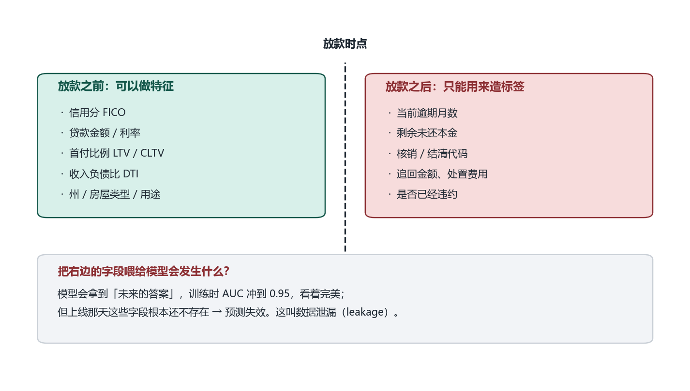

这张图把一个贷款的时间轴分成两段：绿色是「放款时就已经知道的」，红色是「放款之后才发生的」。特征只能来自绿区，标签来自红区。**两段之间的那条竖线，是整个项目最重要的一条线。**

### 3.3 灰区：`orig_rate`（利率）到底能不能用

这是本项目最值得在面试里讲的一个细节。

`orig_rate` 的 IV 高达 **0.4510**（强），是第二重要的特征。但它有个隐患：

> 银行放款时的利率是**风险定价**的结果——信用分低、首付少的客户，利率本来就更高。

也就是说，利率里**已经包含了信用分和 LTV 的信息**。把它喂给模型，等于同一份信息被算了两遍：

- 好处：模型抓住了银行的定价逻辑，效果更好
- 坏处：一旦换了定价策略（比如促销降息），模型就会失灵；而且它部分「复制」了别人的判断，而不是自己发现风险

**本项目的处理**：保留它，但在报告的 Limitations 里明确写出这一点，并建议做一次「去掉 `orig_rate` 的对照实验」看评分卡是否还站得住。

> 面试价值：主动指出自己模型的一个弱点，并说清楚为什么保留、怎么验证——这比多背一个指标有说服力得多。**诚实的局限性比漂亮的结论更专业。**

---

## 第 4 章 · 时间外检验：为什么不能随机切数据

### 4.1 随机切分在这里是作弊

教科书上的做法是 `train_test_split(random_state=42)`：随机抽 80% 训练，20% 测试。在信贷场景，这是错的。

原因：**随机切分把同一个时间段的贷款分到了两边。**

- 训练集里有 2020 年 3 月的贷款，测试集里也有 2020 年 4 月的贷款。
- 这两个月的借款人面对的是同一个利率环境、同一个失业率、同一场疫情。
- 模型只要「知道 2020 年这一批人整体容易违约」，就能在测试集上拿高分——**它学到的是「年份」这个暗号，而不是「什么样的借款人会违约」**。

真正上线时，模型要预测的是**未来**的借款人，训练时一个都没见过。所以测试集必须在时间上**在训练集之后**。

### 4.2 我们的切法：按放款年份（vintage）三刀


| 集合 | 放款年份 | 笔数 | 违约率 | 用途 |
|---|---|---|---|---|
| **train** 训练 | 2015–2018 | 183,668 | 2.64% | 拟合模型 |
| **valid** 验证 | 2019 | 48,321 | 5.15% | 调参、选模型、定阈值 |
| **oot** 时间外测试 | 2020–2021 | 99,133 | 2.02% | **只跑一次**，报最终指标 |

这个切法在业界叫 **OOT（Out-of-Time）验证** 或 vintage-based split。三个要点：

1. **验证集也必须在训练集之后**，否则调参过程本身就泄漏了未来。
2. **OOT 只能跑一次**。反复看 OOT 成绩来改模型，等于把 OOT 变成了第二个验证集，它就不再「时间外」了。
3. **年份不是随便切的**，要保证每一段都有足够的坏样本（我们最少的一年也有 400+ 笔违约）。

### 4.3 各年份的真实违约率：为什么中间高、两头低

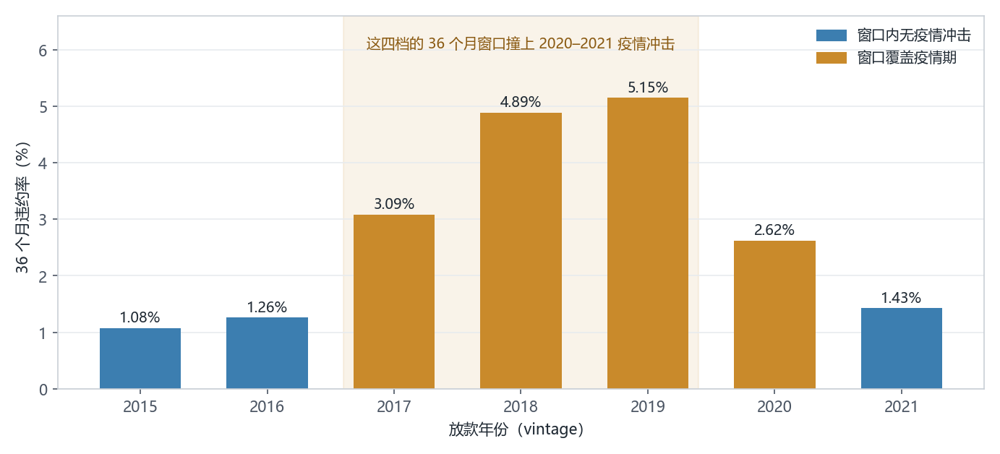

| vintage | 笔数 | 违约率 |
|---|---|---|
| 2015 | 39,629 | 1.08% |
| 2016 | 47,753 | 1.26% |
| 2017 | 48,777 | 3.09% |
| **2018** | 47,509 | **4.89%** |
| **2019** | 48,321 | **5.15%** |
| 2020 | 49,337 | 2.63% |
| 2021 | 49,796 | 1.43% |

这条曲线是**倒 U 形**，很多人第一反应是「数据有问题吧？」。其实这个形状本身就是最好的业务注释：

- **2015–2016 低**：次贷危机后放款标准最严的年份，且美国房价持续上涨，借款人可以靠再融资或卖房脱困。
- **2018–2019 高**：这两批贷款在 2020 年撞上疫情，正好落在它们违约风险最高的第 13–24 个月。
- **2020–2021 低**：疫情期间的超低利率 + 大规模政府救助（CARES Act 的 forbearance 政策允许暂停还款），把违约率压到了历史低位。

**这不是 bug，是宏观冲击。** 我们做过对照验证：按「报告年份」统计还款文件里 90+ DPD 的占比——

| 还款文件 | 2019 | 2020 | 2021 | 2022 |
|---|---|---|---|---|
| `perf_2017` | 0.301% | **2.317%** | **3.402%** | 1.663% |
| `perf_2019` | — | 1.671% | 2.815% | — |
| `perf_2021` | — | 0.174% | 0.493% | — |

2017 与 2019 两批贷款在 2020–2021 年逾期率明显抬升，而 2021 年放款的贷款全程平稳。这就证明了「中间几年违约率高」是真实的经济事件，不是我们把列读错了。

### 4.4 结果长什么样，以及一个反直觉的现象

| 集合 | 评分卡 AUC | GBM AUC |
|---|---|---|
| train（2015–2018） | 0.7805 | **0.7993** |
| valid（2019） | 0.7050 | 0.7040 |
| **oot（2020–2021）** | **0.7462** | 0.7381 |

注意 **valid（2019）反而比 oot（2020–2021）更低**。这不正常吗？

不。因为 2019 那批贷款的违约率是 7 年里最高的（5.15%），而且里面混着大量「本来会违约、但被疫情救助政策救回来」的贷款——这些贷款的标签是「正常」，但它们的特征是「坏客户特征」。**标签被政策扭曲了，模型的区分度自然下降。**

这个现象的意义是：

> 模型的 AUC 会随宏观环境波动。**所以永远不能只报一个 AUC 数字，必须报「每个 vintage 分别多少」**（见第 7 章的 PSI 与分年份表）。

### 本章小结：一句话记住

> **随机切分测的是「你能不能记住这个时代」，时间外切分测的是「你能不能预测下一个时代」。** 银行只关心后者。

---

## 第 4.5 章 · 给零基础读者的 ML 最小知识

> **这一章是给「完全没学过机器学习」的人补底子的。** 如果你已经知道什么是训练、什么是过拟合，可以直接跳到第 5 章。
> 读完之后你应该能回答三个问题：**模型到底是什么？训练在干什么？为什么简单的模型有时反而更好？**

### 4.5.1 机器学习就是「规则由数据算出来」

先把最容易混淆的一点说清：**机器学习不是让电脑变聪明，而是换了一种「编写规则」的方式。**

传统编程是：人把规则想好，写成代码。比如「FICO 低于 620 就拒绝」，这条规则是人拍的。

机器学习是：人只给数据和答案，**让电脑自己找出「什么样的组合该拒绝」**。

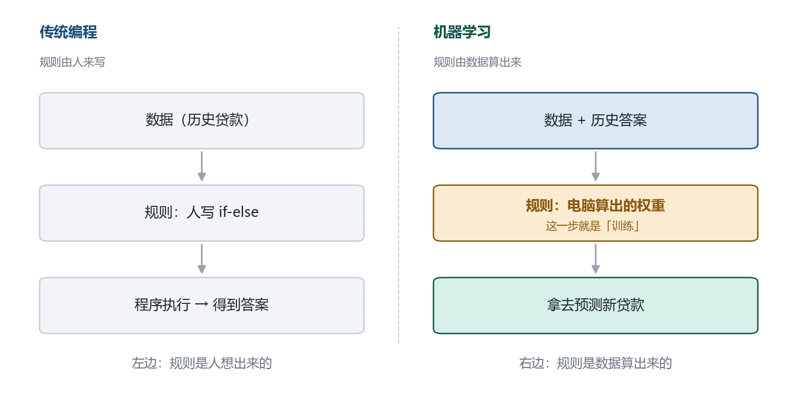

| | 传统编程 | 机器学习 |
|---|---|---|
| 谁定规则 | 人（程序员想清楚） | 数据（电脑算出来） |
| 输入 | 数据 + **规则** | 数据 + **历史答案** |
| 输出 | 答案 | **规则** |
| 规则长什么样 | `if fico < 620: reject` | 14 个数字（权重） |
| 人还能读懂吗 | 能 | 评分卡能，GBM 不能 |

**为什么信贷要用后者**：影响违约的因素有十几个，它们之间还有组合效应（FICO 700 但首付只有 5% 的人，可能比 FICO 660 但首付 40% 的人更危险）。这种关系人脑拍不出来，只能让数据说。

### 4.5.2 这个项目里，哪一步才算是 ML

这是最需要澄清的一点。开场那句「用 ML 做违约预测」，其实会让很多人误以为整个项目都是算法。真实情况是：

| 步骤 | 做什么 | 算 ML 吗 |
|---|---|---|
| 1. 读文件、拼表、造标签 | 两份 txt 合成宽表，算出「谁违约了」 | 不是（数据工程） |
| 2. 切分数据 | 按放款年份分训练 / 验证 / 时间外 | 不是（数据工程） |
| 3. 分箱、算 WOE 和 IV | 把 FICO 切段，算每段的坏人浓度 | 边缘（叫「特征工程」，规则由人设计） |
| **4. 训练模型** | **让电脑自己找出一组权重** | **是——唯一纯 ML 的一步** |
| 5. 算 AUC、校准、PSI | 检查结果靠不靠谱 | 不是（统计评估） |

对应到代码：第 4 步就是 `src/cdr/models.py` 那 64 行。**剩下的 1,500 多行，全在处理「数据对不对」。**

这不是本项目偷懒，是行业常态：

> **一个 ML 项目里，真正的算法代码通常不到 10%，剩下 90% 是数据工程和评估。** 而报告里最值钱的内容（第 2、3、4 章那些坑），恰恰全在那 90% 里。

### 4.5.3 「模型」到底是什么：一组数字

这是理解 ML 的关键一跳。**训练结束保存下来的那个模型文件，里面装的就是一堆数字。**

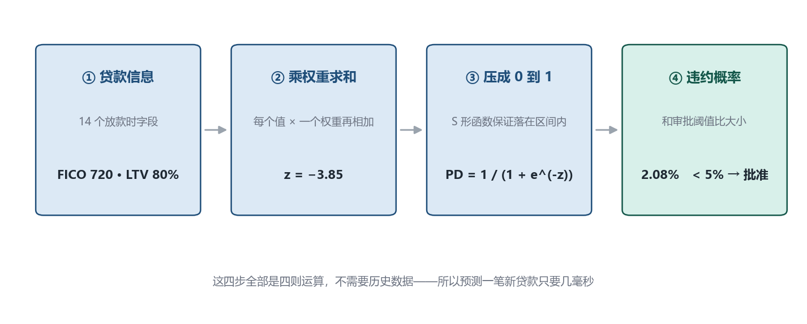

以本项目的评分卡为例，用自己的话走一遍这笔贷款：

| 步骤 | 发生什么 | 具体数字 |
|---|---|---|
| ① 输入 | 取这笔贷款的 14 个放款时字段，每个先换算成 WOE 值 | FICO 720 → WOE = −0.42 |
| ② 加权求和 | 每个 WOE 乘上它自己的权重，全部加起来，再加截距 | z = **−3.85** |
| ③ 压成概率 | 过一个 S 形函数，把任意实数压进 0–1 | PD = 1/(1+e^3.85) = **2.08%** |
| ④ 决策 | 和审批阈值比大小 | 2.08% < 5% → **批准** |

`e^3.85 ≈ 47`，所以 `PD = 1/(1+47) ≈ 0.0208`。**这就是模型预测的全部数学**——四则运算加一个指数函数，没有别的。

> 说明：上表里 WOE 和 z 的具体数值是为了讲清计算链路而举的例子，不是某一笔真实贷款的取值；
> 但「z → PD」的换算公式、「PD 和 5% 阈值比大小」的决策逻辑，都是项目里真实使用的。

两个由此得出的结论：

1. **预测一笔新贷款不需要历史数据**，也不查数据库，只是做 14 次乘法和 14 次加法。所以线上评分只要几毫秒。
2. **「模型」不是一段逻辑，是一组参数。** 换个数据集重新训练，代码一行不改，只是那 14 个数字变了。

### 4.5.4 「训练」在干什么：反复调这组数字

既然模型就是一组数字，那训练就是**找出这组数字**的过程。它是一个循环：

| 轮次 | 电脑做什么 |
|---|---|
| 初始化 | 先随便给 14 个权重（比如全是 0），此时模型基本是瞎猜 |
| 前向 | 拿 18 万笔历史贷款，逐笔算出 PD |
| 比对 | 和真实结果对照：这笔算 2%，实际违约了 → 差得远 |
| 汇总误差 | 把所有差异汇总成一个数字，叫**损失（loss）**——「错得有多离谱」的单一度量 |
| 微调 | 把 14 个权重各挪一点点，让损失变小 |
| 回到第 2 步 | 重复几百到几千次，直到损失不再下降 |

「往哪个方向挪」这件事叫**梯度下降**：把损失想象成一片山地，你蒙着眼站在某处，摸一下脚下的坡度（梯度），朝下坡方向走一小步，再摸一次、再走一步。走几千步就到谷底了。

> 用你本科学过的话说：**这就是一个最优化问题——在 14 维参数空间里找损失函数的极小值。** 机器学习听起来新，底层数学你在信息与计算科学专业都学过。

**那为什么还说要「学 ML」**：因为工程上有大量细节——步子迈多大（学习率）、什么时候停（早停）、怎么防止它钻进一个假谷底（正则化）、怎么判断它是真学会了还是背下来了（验证集）。这些才是 ML 课程的实际内容。

顺带说一句：这段循环用现成的库只要五行代码。

```python
from sklearn.linear_model import LogisticRegression
model = LogisticRegression(C=1.0, max_iter=1000)
model.fit(X_train, y_train)      # 这一步就是「训练」
pd_hat = model.predict_proba(X_new)[:, 1]   # 这一步就是「预测」
```

**所以本项目真正的技术含量，不在调用它，而在「喂给它的 X 和 y 对不对」。** 那正是第 2、3、4 章的全部内容。

### 4.5.5 决策树 → 随机森林 → 梯度提升：三个模型的关系

评分卡是「一条直线」，它假设每个特征的影响是均匀、可加的。但真实世界有拐点、有组合效应。这就轮到树模型。

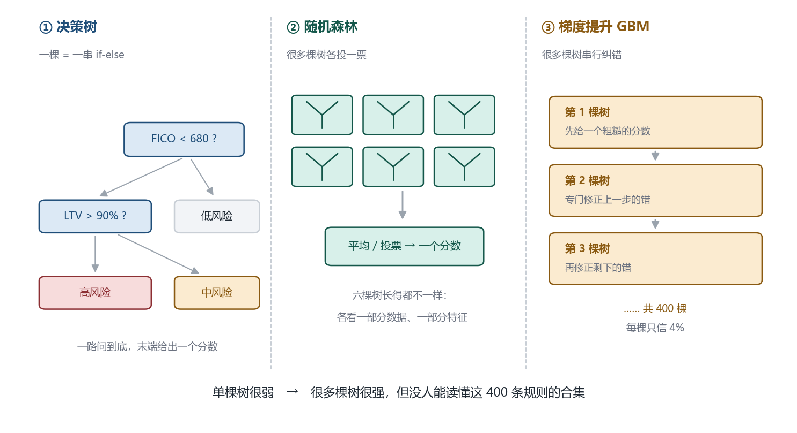

#### 第一代：决策树（Decision Tree）

一句话：**一串 if-else 问题，一路问到底。**

```
如果 FICO < 680 ?
   ├─ 是 → 如果 LTV > 90% ? → 高风险
   └─ 否 → 低风险
```

- **优点**：极其直观，能画出来给人看，天然处理「拐点」和「组合条件」。
- **致命缺点**：**单棵树太容易背答案。** 只要允许它一直分下去，它可以把每一个客户单独分到一个叶子节点，训练集准确率 100%，但换一批人就废了。
- 这棵树长多深，是它能记住多少噪声的开关。这就是第 6 章 `max_depth = 4` 的由来——**故意不让它长太深。**

#### 第二代：随机森林（Random Forest）

一句话：**种几百棵树，让它们各投一票。**

做法是「三个臭皮匠」：

1. 从 18 万笔贷款里**有放回地**随机抽 18 万笔，抽出一个新样本集（有的人被抽中两次，有的人没被抽到）
2. 从 14 个特征里随机挑几个（比如每次只看 4 个）
3. 用这套数据种一棵树
4. **重复 400 次，得到 400 棵互不相同的树**
5. 预测时让 400 棵树各给一个分数，取平均

为什么这样更好？因为每棵树都只看了一部分数据和一部分特征，**它们犯的错互不相关**。400 个独立的错误加在一起会互相抵消——这叫**降低方差**。

> 类比：问一个人估计一袋糖有多少颗，他可能偏多也可能偏少；问 400 个互相不看对方答案的人，然后取平均，结果会准得多。

注意关键点：**400 棵树是同时训练的，彼此独立，可以并行。** 这是随机森林的工程优势。

#### 第三代：梯度提升（Gradient Boosting / GBM）

一句话：**树不是并排种的，是一棵接一棵种的，每棵专门去改前一棵的错。**

```
第 1 棵树：先给一个粗糙的分数（比如所有人都是 2%）
第 2 棵树：只看「第 1 棵树错在哪里」，专门修正那些错
第 3 棵树：再修正前两棵加起来还没修好的错
...
第 400 棵树：把残差磨到很小
最终分数 = 400 棵树的输出全部相加
```

和随机森林的差别，一张表说清：

| | 随机森林 | 梯度提升 GBM |
|---|---|---|
| 树的训练方式 | **并行**，互不相干 | **串行**，后一棵依赖前一棵 |
| 每棵树的作用 | 各自独立给意见 | **专门纠正前面的错误** |
| 主要降低什么 | 方差（让结果更稳） | **偏差**（让结果更准） |
| 每棵树的贡献 | 平等投票 | 每棵只占一点点（本项目 `learning_rate = 0.04`） |
| 过拟合风险 | 较低，树多一般没事 | **较高**，必须早停 |
| 典型调参 | 树的数量、每次看几个特征 | 学习率、树深、树的数量 |

> 类比：随机森林是「400 个学生各自做一遍卷子然后取平均分」；梯度提升是「一个学生做卷子，老师只圈出错题，他再做一遍专门订正这些错题，反复 400 轮」。

**本项目为什么选 GBM 而不是随机森林**：在表格数据（不是图像、不是文本）上，GBM 通常是性能上限，而且它对学习率的控制（每棵只信 4%）比随机森林「一次投满票」更细腻。代价就是它更容易过拟合，所以必须配早停。

**但两个都要注意同一件事**：400 棵树加起来是几千条规则，**没人读得懂**。这就是银行宁可要 AUC 低一点的评分卡的原因——见第 6.1 节。

### 4.5.6 过拟合：ML 最核心的那个坑

如果整章只能记住一个概念，记这个。

> 两个学生考试。A 理解了原理，B 把模拟卷的答案连题号一起背下来了。
> 再考**同一张卷子**：B 考 100，A 考 80。
> 换一张**没见过的新卷子**：B 考 60，A 考 78。

B 就是过拟合（overfitting）：**它不是学会了规律，而是记住了这份数据里的偶然。** 而「偶然」换个样本就不成立了。

我们的两个模型正好演了一遍这件事：

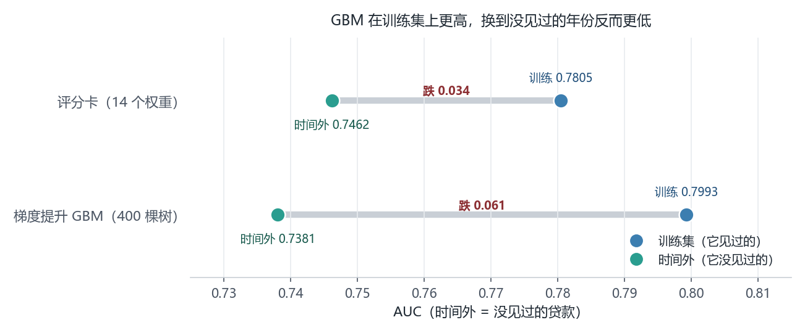

| 模型 | 训练集 AUC | 时间外 AUC | 落差 |
|---|---|---|---|
| 梯度提升 GBM（400 棵树） | **0.7993** | 0.7381 | **−0.061** |
| 评分卡（14 个权重） | 0.7805 | **0.7462** | −0.034 |

- GBM 在**它见过的数据**上确实更高（0.7993 > 0.7805）——它有能力拟合更多细节，包括噪声。
- 但换到**没见过的新贷款**，它掉得更多，最后反而输给只有 14 个参数的评分卡。

**这不是 GBM 不行，是没有把它管住。** 三个刹车（第 6.4 节有细节）：

| 刹车 | 配置 | 作用 |
|---|---|---|
| 限制树深 | `max_depth = 4` | 不许它把每个客户单独分一格 |
| 每棵只信一点 | `learning_rate = 0.04` | 400 棵小步走，不许一棵树说了算 |
| **早停** | `early_stopping = true` | 验证集不再变好就立刻停，这是最有效的一根 |

**这件事的普适意义**：

> **模型在训练集上的分数，几乎没有任何意义。** 它唯一能告诉你的是「模型有没有能力拟合」，不能告诉你「它学会了没有」。
> 所以本项目所有的结论都用时间外（OOT）的数字——这也是整份报告和第 4 章存在的理由。

### 4.5.7 学到这里就够了：知识点地图

| 概念 | 一句话 | 学到什么深度 |
|---|---|---|
| 特征 X / 标签 y | X 是题目（FICO、DTI），y 是答案（违没违约） | **必须能举例** |
| 训练 / 拟合 | 反复调参数，让预测贴近答案 | **必须能讲清循环** |
| 参数 / 权重 | 模型最终学到的那组数字 | **必须**（评分卡 = 14 个） |
| 损失函数 | 给「错得多离谱」打分的尺子 | 知道存在即可 |
| 梯度下降 | 摸坡度、往下坡走一小步 | 能用「下山」讲清即可 |
| 逻辑回归 | 加权求和 → S 形压缩成概率 | **必须**（评分卡本体） |
| 决策树 | 一串 if-else，天然处理拐点 | 能画出一棵小树即可 |
| 随机森林 | 很多棵树并行投票，降方差 | 知道「并行 + 投票」即可 |
| 梯度提升 GBM | 很多棵树串行纠错，降偏差 | 知道「串行 + 纠正残差」即可 |
| 训练 / 验证 / 测试集 | 学、边学边查、只考一次 | **必须** |
| 过拟合 | 背答案，换卷子就废 | **必须能举例子** |
| 正则化 / 早停 | 防过拟合的两根缰绳 | 知道在防什么即可 |
| 类别不平衡 | 只有 2% 违约，准确率会骗人 | **必须**（见 7.0） |
| 特征工程（WOE / IV / 分箱） | 把原始数字改造成模型好用的形状 | **必须**（信贷特化） |

加粗的 8 个，是面试任何数据岗都会问的；其余几个能用自己的话解释一句就够，**不需要会推导**。

**如果要从零开始学，按这个顺序，一周能到「能聊」**：

1. **逻辑回归**（1 天）—— 搞懂「乘权重 → 求和 → S 函数」，你就懂了这个项目 70% 的模型部分
2. **训练集 / 验证集 / 测试集 + 过拟合**（1 天）—— 这是 ML 的**思维方式**，比任何算法都重要
3. **决策树 → 随机森林 → GBM**（2 天）—— 理解「一串 if-else」「并行投票」「串行纠错」三个画面就够了
4. 剩下的（正则化、调参、集成细节）边做边查，不需要提前学完

> **最后一句话**：这个项目的技术难点不在 ML 算法（那是调库），而在**数据对不对、标签对不对、验证方式对不对**。
> 你能把第 2、3、4 章三个坑讲清楚，比会背十个算法更能证明你做过真实项目。

---

## 第 5 章 · 特征工程：分箱、WOE、IV

### 5.1 为什么要先分箱

模型吃的是数字。但很多风险关系**不是一条直线**：

- FICO 800 分和 780 分，风险几乎没差别
- FICO 620 分和 600 分，风险差很多

如果直接把 FICO 当连续变量塞进逻辑回归，模型只能拟合出「FICO 每降 1 分，风险升一点点」这种均匀的直线关系——**错过了「低分段风险陡增」这个最关键的信息**。

分箱（Binning）就是先把连续变量切成几段，再让模型去学「每一段的风险水平」。相当于把一条平滑的斜线，换成一段一段的台阶——台阶能贴合任何形状的曲线。

行业里常用两种分箱：

| 方式 | 做法 | 特点 |
|---|---|---|
| 等频分箱 | 每箱样本数相同（如十分位） | 稳、简单、样本均衡 |
| **决策树分箱** | 让树去找「切在哪里最能区分好坏」 | 更贴合实际风险拐点 |

本项目用**决策树分箱**（`woe_max_bins = 10`），因为它能自动找到 FICO 630、680、720 这种真实的信用断点。

### 5.2 WOE：把「箱子里有多少坏人」翻译成一个数

分完箱之后，每个箱子里算一个 **WOE（Weight of Evidence，证据权重）**：

```
WOE_i = ln( 该箱坏人占全部坏人的比例 / 该箱好人占全部好人的比例 )

      = ln( ( bad_i / bad_total ) / ( good_i / good_total ) )
```

怎么理解这个公式？用大白话：

> 分子是「全部坏人里，有多大比例落在这个箱子」；
> 分母是「全部好人里，有多大比例落在这个箱子」。
>
> - 两者相等 → 这个箱子对好坏没有区分力 → WOE = ln(1) = **0**
> - 分子更大 → 这个箱子**坏人相对更多** → WOE **为正**
> - 分母更大 → 这个箱子**好人相对更多** → WOE **为负**

它回答的问题非常具体：**「这个箱子里坏人的浓度，比全样本平均浓度高还是低，高多少倍」**。取对数是为了让「2 倍」和「0.5 倍」对称（ln2 = 0.69，ln0.5 = −0.69）。

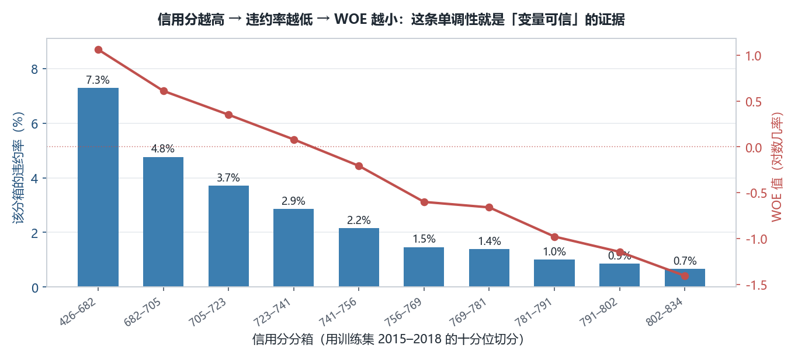

这张图是用你的真实数据算出来的。上面那张是**每个 FICO 箱的违约率**（单调下降，符合常识：分数越高越安全）；下面那张是同一批箱子的 **WOE 值**（从正数一路降到负数）。

为什么这个形状好：

- **单调**（越来越好或越来越坏）说明关系干净，模型容易学。
- 如果 WOE 曲线**忽高忽低**（例如 700 分比 680 分风险高），通常说明这一箱样本太少，或者数据有问题。

### 5.3 IV：把一个变量的所有箱折成一个数

WOE 是「每个箱子一个数」，不好比较变量之间的强弱。所以再定义一个 **IV（Information Value，信息值）**：

```
IV = Σ_i ( bad_dist_i − good_dist_i ) × WOE_i
```

翻译成大白话：**把每个箱子的「坏人浓度差」乘以「这个差有多显著」，再加起来。** 好坏分布差得越远、越分散，IV 就越大。

行业通用的判读阈值：

| IV | 含义 | 动作 |
|---|---|---|
| < 0.02 | 无用 | 删掉 |
| 0.02 – 0.1 | 弱 | 可保留，作用不大 |
| 0.1 – 0.3 | 中等 | 好特征 |
| 0.3 – 0.5 | 强 | 核心特征 |
| **> 0.5** | **可疑** | **必须查是不是泄漏** |

注意最后一档。IV 太大不是好消息——**它往往是「答案混进来了」的信号。**

### 5.4 我们的实测 IV 表（真实数据，训练集）

| 特征 | IV | 强弱 | 说明 |
|---|---|---|---|
| **fico** 信用分 | **0.5690** | 可疑 | 最强，需要核对是否有泄漏 |
| **orig_rate** 放款利率 | **0.4510** | 强 | 见第 3.3 节的灰区讨论 |
| dti 债务收入比 | 0.2278 | 中等 | 负债越重越容易违约，符合预期 |
| cltv 组合贷款价值比 | 0.1381 | 中等 | 抵押物覆盖率 |
| ltv 贷款价值比 | 0.1341 | 中等 | 首付越少风险越高 |
| state 州 | 0.1242 | 中等 | 地区经济差异 |
| term_months 期限 | 0.0637 | 弱 | 30 年 vs 15 年 |
| loan_purpose 贷款用途 | 0.0273 | 弱 | 购房 / 再融资 / 套现 |
| mi_pct 保险比例 | 0.0152 | 无用 | 高 LTV 才有，缺失很多 |
| channel 渠道 | 0.0144 | 无用 | 零售 / 经纪 / 代理 |
| orig_upb 原始本金 | 0.0101 | 无用 | 金额本身不代表风险 |
| occupancy 自住/投资 | 0.0083 | 无用 | |
| num_borrowers 借款人数 | 0.0053 | 无用 | |
| property_type 房型 | 0.0022 | 无用 | |

**关于 FICO 的 IV = 0.5690 为什么标「可疑」**：不是因为怀疑数据错了，而是因为**必须排除一种可能**——如果我们不小心把「当前逾期月数」读进了 `fico` 这一列（列错位），IV 就会异常高。核查方式是看 WOE 曲线是否单调、是否与经济常识一致（第 5.2 节的图证明它一致），以及是否和公开研究里 FICO 的预测力范围相符（业界普遍 IV 在 0.4–0.6，属于正常）。

> **这就是把 IV 阈值当「检查清单」而不是「评分表」的用法**：它不替你决定删不删，它提醒你去核查。

### 5.5 WOE 编码的三个好处

把原始值换成 WOE 值再进模型，不是多此一举，而是解决三个具体问题：

1. **非线性变成线性**：WOE 和「对数几率」之间是线性关系，正好符合逻辑回归的假设。
2. **缺失值可控**：缺失单独分一箱，算它自己的 WOE。不必填均值（会造假），也不必丢样本（会浪费）。
3. **异常值免疫**：FICO 有个 999 的哨兵值，分箱后它自然落进「缺失」或「最高分」箱，不会把回归系数拉歪。

代码里对应 `config.json` 的这个参数：

```json
"features": { "numeric": [...], "categorical": [...], "woe_max_bins": 10 }
```

---

## 第 6 章 · 模型：评分卡 vs 梯度提升

### 6.1 两个模型的定位完全不同

| | **评分卡（Scorecard）** | **梯度提升（GBM）** |
|---|---|---|
| 本质 | 逻辑回归 + WOE 编码 | 几百棵决策树逐步纠错 |
| 可解释性 | **每一项权重都能算成人话** | 只能事后用 SHAP 解释 |
| 需要的监管文档 | 简单 | 复杂，很多地区不接受纯黑箱 |
| 性能上限 | 中 | **高** |
| 在项目里的角色 | **可以真的上线** | **性能参照线（上限）** |

这不是「哪个更好」的问题，而是「银行实际会批准哪个」。评分卡的每一个系数都能写进审批手册、向监管解释、被审计追溯；GBM 在训练集上一定赢，但它答不出「为什么拒了这位客户」这个合规必答题。

所以本项目的做法是：**两个都训练，报告里并列，结论以评分卡为准，GBM 用来验证「我们离性能天花板还有多远」。**

> 如果你还不清楚「几百棵决策树逐步纠错」是什么意思，回看 **4.5.5 节**（决策树 → 随机森林 → GBM）。

### 6.2 评分卡的系数怎么读

训练出来的系数（`woe_coefficient`）不能直接读，因为 WOE 的尺度不一样。要换算成 **odds_multiplier（优势比倍数）**：

```
odds_multiplier = e ^ coefficient
```

含义：**这个特征的 WOE 每升高 1，违约几率变成原来的多少倍。**

| 特征 | WOE 系数 | odds_multiplier | 读法 |
|---|---|---|---|
| orig_upb | 1.0786 | 2.94 | 本金越高、风险越高（$ 金额是房价的代理） |
| state | 0.8156 | 2.26 | 州之间的差异很大（地区经济） |
| channel | 0.8145 | 2.26 | 渠道风险差异 |
| **fico** | 0.7997 | 2.22 | **信用分每降一个「坏人浓度档」，违约几率涨 1.2 倍** |
| orig_rate | 0.6846 | 1.98 | 利率隐含的银行定价判断 |
| dti | 0.6748 | 1.96 | 负债率 |
| occupancy | 0.4300 | 1.54 | 投资房比自住房风险高 |
| ltv | 0.3828 | 1.47 | 首付越少风险越高 |
| term_months | −0.3519 | 0.70 | 期限越长风险越低（15 年期月供高但还得快） |
| cltv | 0.3311 | 1.39 | 组合 LTV |
| loan_purpose | 0.3132 | 1.37 | 套现再融资风险最高 |
| num_borrowers | 0.2617 | 1.30 | 双人借款略稳 |
| property_type | 0.2178 | 1.24 | 房型 |
| mi_pct | −0.2011 | 0.82 | 有保险的贷款风险略低 |

**全部系数为正（除 term_months / mi_pct）** 是一个重要的健全性检查：WOE 已经统一了方向（WOE 越大 = 坏人越多），所以系数都应该是正的。如果出现「FICO 的系数是负的」这种反常识结果，说明分箱方向搞反了或多重共线性严重。

### 6.3 为什么 GBM 训练集赢 0.019，OOT 反而输 0.008

| 集合 | 评分卡 | GBM | 差值 |
|---|---|---|---|
| train | 0.7805 | **0.7993** | GBM +0.0188 |
| valid | **0.7050** | 0.7040 | GBM −0.0010 |
| oot | **0.7462** | 0.7381 | GBM −0.0081 |

这是**过拟合的教科书级示例**：

- 训练集上 GBM 的 AUC 更高 → 因为它能记住更多细节，包括噪声。
- 一旦换到没见过的年份，那些被记住的噪声变成错误 → 优势消失甚至反转。
- 评分卡只有 14 个参数，学不了噪声，所以**跨时间的衰减更小**。

这个对比是整份报告最有说服力的一段：

> **不是「复杂模型更好」，而是「复杂模型在旧数据上更好」。** 在信贷这种要穿越经济周期的场景，简单模型的稳健性经常等于甚至超过复杂模型的上限优势。

### 6.4 防过拟合的三个具体手段

`config.json` 里 GBM 的配置：

```json
"gbm": {
  "max_iter": 400,
  "learning_rate": 0.04,
  "max_depth": 4,
  "l2_regularization": 1.0,
  "early_stopping": true
}
```

| 参数 | 值 | 作用 |
|---|---|---|
| `max_depth` | 4 | 每棵树最多 4 层。树太深会记住个别客户 |
| `learning_rate` | 0.04 | 每棵树的贡献只取 4%，慢慢逼近。小步走不容易过拟合 |
| `max_iter` | 400 | 最多 400 棵树 |
| `early_stopping` | true | **验证集不再变好就停**——这是最有效的刹车 |
| `l2_regularization` | 1.0 | 惩罚过大的系数，把模型往「平滑」方向压 |

评分卡那边对应的是 `C = 1.0`（逻辑回归的正则化强度倒数，`C` 越小正则化越强）。

**早停（early stopping）尤其要能讲清楚**：它在训练过程中不断在验证集上打分，一旦连续若干轮没有改善就停下。这意味着 `valid`（2019 年）参与了「决定训练几轮」——这是允许的，因为 `valid` 在时间上仍早于 `oot`，且 `oot` 从未被用于任何决策。

---

## 第 7 章 · 评估：五个指标，各回答什么问题

模型跑完了，现在要回答「它到底好不好」。**没有单一指标能回答这个问题**，因为「好」有五个不同的含义。

### 7.0 先把 AUC 讲透（不然 7.1 看了也白看）

教材对 AUC 的定义是「ROC 曲线下的面积」——这句话等于没说。它真正想表达的意思非常朴素：

> **随便抓一个「实际会违约」的人，再抓一个「实际不会违约」的人，模型给违约那个人打的分数更高的概率有多大。**

如果模型给 100 对这样的人排序，有 75 对排对了，AUC 就是 **0.75**。这就是全部。

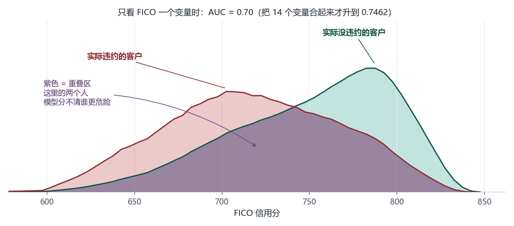

上面这张图是用**你的真实数据**画的（33 万笔贷款，横轴就是 FICO 分数）。蓝色是实际没违约的客户，红色是实际违约的客户。

看见那个紫色区域了吗？**那就是两个人群的分数重叠的地方**——在这些分数段里，好人和坏人的分数差不多，模型排不出先后。所以：

- 两条曲线**完全分开**（好人分数永远高于坏人）→ AUC = 1.0，完美
- 两条曲线**完全重合**（分数和好坏完全无关）→ AUC = 0.5，等于抛硬币
- 重叠越多，AUC 越接近 0.5

**注意图上的一个细节**：只看 FICO 一个变量时，AUC 只有 **0.70**。而我们最终的模型是 **0.7462**。差的这 0.046 是从哪来的？——**从另外 13 个变量里。** 这正是「多变量模型」的意义：单看一个指标只能分到这个程度，把 DTI、LTV、利率、州一起看，就能把重叠区再压窄一点。

#### 那为什么它叫「曲线下面积」

因为还有一个等价画法。把这个模型在**所有可能的切分阈值**上都试一遍，把「误伤的好人比例」当横轴、「抓到的坏人比例」当纵轴，就得到一条曲线；**这条曲线下面的面积，数值上恰好等于上面那个概率**。这不是巧合，是同一个东西的两种量法。

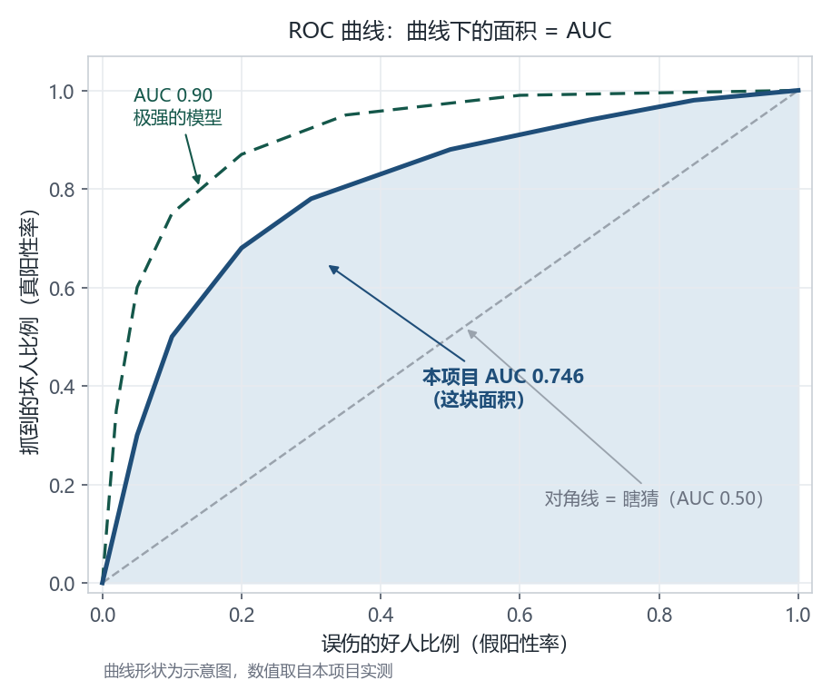

- 沿对角线走 = 完全瞎猜（误伤 10% 好人只换来抓到 10% 坏人），面积 0.5
- 曲线越往**左上角**鼓，说明「很少误伤就能抓到很多坏人」，面积越大
- 我们这条曲线在「误伤 10% 好人」时已经抓到了 50% 的坏人——这就是 0.746 的实际含义

#### 多少算好

| AUC | 含义 | 在信贷场景 |
|---|---|---|
| 0.50 | 抛硬币 | 模型没用 |
| 0.60 | 有一点区分力 | 太弱，不能上线 |
| 0.70 | 可用 | 及格线 |
| **0.746** | **本项目（时间外）** | **扎实，能上线的水平** |
| 0.80 | 好 | 优秀 |
| 0.90 | 极强 | **房贷里基本不可能**，出现要先怀疑泄漏 |

#### 两个必须避开的误区

**误区一：AUC 高就代表模型「准」。**

不对。想想我们的数据：OOT 里只有 2.02% 的贷款违约。如果一个模型**什么都不学，对所有贷款都说「不会违约」**，它的准确率是 **97.98%**——比任何真模型都高。所以在这种极度不平衡的问题里，**准确率是个骗人的指标**，AUC 才是能用的那个。

**误区二：AUC 0.746 代表「预测 PD 是 3% 的人，真有 3% 会违约」。**

也不对。**AUC 只管排序，不管数值。** 它只保证「坏人的分数比好人高」，不保证分数本身的绝对水平准不准。这正是 7.4 节校准表要解决的问题：我们那个模型排序没问题，但 PD 数值系统性偏低，所以结论是「**能用来批不批，不能直接用来定价**」。

一句话记住分工：

> **AUC 回答「谁更危险」，校准回答「到底有多危险」。** 前者决定准入，后者决定定价。

### 7.1 Gini：同一个东西的另一个刻度

信贷行业更爱用 Gini，因为它的数字看起来更「整」。公式就一行：

```
Gini = 2 × AUC − 1
```

| | AUC | Gini |
|---|---|---|
| 评分卡 | 0.7462 | **0.4924** |
| GBM | 0.7381 | 0.4762 |

参考标准：Gini 0.4–0.6 属于「可上线的零售信贷模型」区间。**0.492 是扎实的成绩**，不是刷出来的（因为它是时间外测试）。

另外记住 AUC 的一个好性质：**它不受违约率高低的影响**。所以 2019（违约率 5.15%）和 2021（违约率 1.43%）的 AUC 可以直接比——这是 7.3 节能做「逐年稳定性」检查的前提。

### 7.2 KS：好坏分布的最大裂缝

**它回答**：在最优的那个切点上，我能把多少坏人挑出来，同时不误伤太多好人？

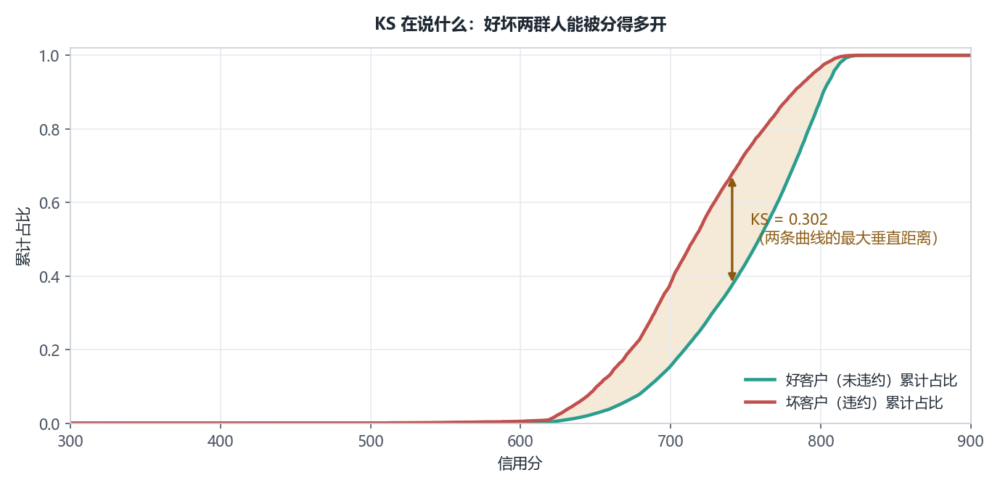

做法：把 OOT 样本按模型分数从低到高排序，画两条累计曲线——坏人的累计占比、好人的累计占比。**两条曲线的最大垂直距离就是 KS。**

- KS = 0 → 好坏分不开
- KS = 0.3 → 常用及格线
- **本项目 KS = 0.3754**

KS 和 AUC 的区别（面试常问）：

| | AUC | KS |
|---|---|---|
| 考虑范围 | **整条曲线**（所有可能的切点） | **只看最优的那一个切点** |
| 业务含义 | 整体排序质量 | 单点决策能力（风控最关心） |
| 受违约率影响 | 小 | 较大 |

两者一起报，是因为一个看全局、一个看实操。

### 7.3 PSI：模型会不会随时间失效

**它回答**：新来的客户和训练时的客户，还是同一批人吗？

PSI（Population Stability Index，群体稳定性指数）比较两个分布：

```
PSI = Σ_i ( 实际占比_i − 预期占比_i ) × ln( 实际占比_i / 预期占比_i )
```

判读阈值是业界标准：

| PSI | 判定 | 动作 |
|---|---|---|
| **< 0.10** | 稳定 | 正常使用 |
| **0.10 – 0.25** | 需监控 | 加强跟踪 |
| **> 0.25** | 漂移 | 重新校准或重训 |

**特征层面的实测（train vs OOT）：**

| 特征 | PSI | 判定 | 原因 |
|---|---|---|---|
| **orig_rate** | **2.5973** | 严重漂移 | **2021 年利率降到 2.5–3%，而 2015–2018 是 4–5%** |
| **dti** | **0.3162** | 漂移 | 2021 年房价暴涨，借款人的 DTI 结构变了 |
| loan_purpose | 0.1612 | 需监控 | 再融资占比随利率变化 |
| cltv | 0.0949 | 稳定 | |
| ltv | 0.0844 | 稳定 | |
| fico | 0.0255 | 稳定 | **信用分分布几乎没变** |
| 其余 | < 0.06 | 稳定 | |

这张表的信息量很大：

1. **`orig_rate` 的 PSI 高达 2.6，但没有毁掉模型**——因为评分卡是通过 WOE 箱来用它的，而「利率高低」的相对排序在 2021 年仍然成立（低利率客户仍然比高利率客户安全）。
2. **`fico` 的 PSI = 0.0255，几乎是完美的稳定**——这说明模型的核心信号源没有漂移，是它能跨 6 年还保持 0.746 的根本原因。
3. **如果当初用的是随机切分，我们永远看不到这张表**——因为训练和测试的利率环境完全一样。**这就是 OOT 的真正价值所在。**

**分数层面的 PSI（逐年）：**

| vintage | GBM 分数 PSI |
|---|---|
| 2015 | 0.0128 |
| 2016 | 0.0217 |
| 2017 | 0.0436 |
| 2018 | **0.3726** |
| 2019 | 0.1670 |
| 2020 | 0.2283 |
| 2021 | **0.3283** |

2018 年起分数分布明显偏移，原因是**违约率本身在变**（1.26% → 4.89%），而不是模型坏了。这提醒一件事：**PSI 高不等于模型失效，要分清是「人群变了」还是「模型错位了」**。

### 7.4 校准表：预测的 3% 是不是真的 3%

AUC 和 KS 只管「排序」，不管「数值准不准」。但 PD 是要拿来算钱的，**数值必须准**。

做法：把 OOT 样本按预测 PD 分成 10 组，比较「预测平均值」和「实际违约率」。

| 组（风险从低到高） | 样本数 | 预测 PD | 实际违约率 | 缺口 |
|---|---|---|---|---|
| 1（最好） | 9,914 | 0.15% | 0.26% | 0.12% |
| 2 | 9,913 | 0.23% | 0.55% | 0.32% |
| 3 | 9,913 | 0.33% | 0.65% | 0.32% |
| 4 | 9,913 | 0.42% | 0.89% | 0.46% |
| 5 | 9,914 | 0.55% | 1.25% | 0.70% |
| 6 | 9,913 | 0.71% | 1.57% | 0.86% |
| 7 | 9,913 | 0.96% | 2.18% | 1.22% |
| 8 | 9,913 | 1.38% | 2.40% | 1.02% |
| 9 | 9,913 | 2.18% | 4.17% | **1.98%** |
| 10（最差） | 9,914 | 5.28% | 6.32% | 1.05% |

**结论：全区间系统性低估。** 每一组的实际违约率都高于预测值。

为什么？因为模型是在 2015–2018（违约率 2.64%）上训练的，而 OOT 是 2020–2021（违约率 2.02%）。但**低估的方向说明不是简单的基率问题**，而是风险分层内部的斜率被压缩了。

**这个发现的业务含义非常重要**：

> 模型可以拿来做**排序和准入决策**（谁比谁更危险，这个判断是对的），
> 但**不能直接拿预测的 PD 去定价或算拨备**——会少提坏账准备。
> 上线前必须做**重校准**（recalibration，例如 Platt scaling 或按 vintage 重新锚定基率）。

主动报出这个缺陷，比藏起来强得多。

### 7.5 十分位 lift：模型到底能筛出多少坏人

把 OOT 按风险从高到低分 10 档：

| 档位 | 样本数 | 违约数 | 违约率 | **lift** | 累计捕获坏账 |
|---|---|---|---|---|---|
| **D1（最危险）** | 9,914 | 627 | **6.32%** | **3.12** | 31.2% |
| D2 | 9,913 | 413 | 4.17% | 2.06 | 51.8% |
| D3 | 9,913 | 238 | 2.40% | 1.19 | 63.7% |
| D4 | 9,913 | 216 | 2.18% | 1.08 | 74.4% |
| D5 | 9,913 | 156 | 1.57% | 0.78 | 82.2% |
| D6 | 9,914 | 124 | 1.25% | 0.62 | 88.4% |
| D7 | 9,913 | 88 | 0.89% | 0.44 | 92.8% |
| D8 | 9,913 | 64 | 0.65% | 0.32 | 96.0% |
| D9 | 9,913 | 55 | 0.55% | 0.27 | 98.7% |
| **D10（最安全）** | 9,914 | 26 | **0.26%** | 0.13 | 100% |

两个关键数字：

- **最差档 6.32% ÷ 最好档 0.26% ≈ 24 倍**——这就是模型的实际价值：它把人群按风险差出了 24 倍。
- **D1 + D2 只占 20% 的客户，却捕获了 51.8% 的违约**——如果只能人工复核 20% 的申请，就查这两档，效率最高。

`lift = 该档违约率 ÷ 整体违约率`。D1 的 lift = 3.12 表示「最危险那 10% 的人，坏账率是平均水平的 3.12 倍」。

---

## 第 8 章 · 决策层：从概率到业务动作

### 8.1 一个 PD 数字本身不产生任何价值

模型输出 0.032。然后呢？

必须把它变成一个**动作**：批准 / 拒绝 / 加价 / 人工复核。这一步叫**决策层（decision layer）**，它是模型和钱之间的转换器。

最朴素的做法：定一个**阈值（cutoff）**。

```
PD < cutoff  →  批准
PD ≥ cutoff  →  拒绝
```

阈值定在哪里，直接决定两件事的权衡：

- **阈值调高** → 通过率上升（多做生意）→ 但通过者里坏人变多（坏账上升）
- **阈值调低** → 通过率下降（少做生意）→ 但资产质量变好

### 8.2 cutoff 场景表怎么读

| cutoff PD | 通过率 | 通过者坏账率 | 被拒者坏账率 | 被拒者贡献了多少坏账 |
|---|---|---|---|---|
| **0.05** | **96.23%** | **1.79%** | **8.04%** | 15.0% |
| 0.10 | 99.32% | 1.97% | 9.62% | 3.2% |
| 0.15 | 99.87% | 2.00% | 18.40% | 1.2% |
| 0.20 | 99.97% | 2.02% | 20.00% | 0.3% |
| 0.30 | 100% | 2.02% | — | 0% |

读法（以 0.05 那行为例）：

> 如果把「PD ≥ 5%」的申请全部拒掉，我会拒掉 3.77% 的客户（通过率 96.23%），
> 通过的那批人坏账率从 2.02% 降到 **1.79%**；
> 被拒的那 3.77% 里，坏账率高达 **8.04%**（是全体的 4 倍）；
> 全体坏账里有 **15%** 是被这一刀切掉的。

**为什么 96% 通过率很有吸引力**：只牺牲 3.77% 的业务量，就能把坏账率降低 11%（2.02% → 1.79%），而且被切掉的这批人坏账率是平均的 4 倍——这是很划算的交换。

**为什么没有继续往下砍**：看 0.10 那行，通过率只多 3 个百分点（96.23 → 99.32），但通过者坏账率从 1.79% 回升到 1.97%，被拒者的坏账率反而降到 9.62%（因为拒的人少了，剩下被拒的都是极端坏的）。**边际收益递减**——这就是阈值选择的本质：在「业务量」和「资产质量」之间找拐点。

> **这张表是整份报告最容易被业务方看懂的部分。** 面试时如果只能讲一张表，讲这张——它直接把 AUC 0.746 翻译成了「能省多少坏账」。

### 8.3 定价：PD 怎么变成利率

银行不是只做「批/拒」的二元决策。更常见的是**风险定价**：PD 高的客户也做，但利率加高，用利差覆盖预期损失。

核心公式是**预期损失（Expected Loss）**：

```
EL = PD × LGD × EAD
```

| 符号 | 含义 | 取值范围 | 在我们的数据里 |
|---|---|---|---|
| **PD** | 违约概率 | 0–1 | **模型输出** |
| **LGD** | 违约损失率（违约后收不回的比例） | 0–1 | 房贷通常 0.20–0.35（有抵押物） |
| **EAD** | 违约时敞口（还欠多少钱） | 金额 | 近似取当前余额 |

举例：一笔 PD = 3%、余额 300 万港币、LGD = 25% 的房贷：

```
EL = 0.03 × 0.25 × 3,000,000 = 22,500 港币
```

这 2.25 万必须从利差里赚回来。所以定价至少要是：

```
利率 ≥ 资金成本 + EL/EAD + 运营成本 + 资本占用成本 + 目标利润
```

其中 `EL / EAD = PD × LGD = 0.75%` —— **这就是「PD 直接决定利率」的机制**。

> 注意：第 7.4 节说过我们的 PD 系统性低估。如果拿低估的 PD 去定价，就会**定价不足**——收的利息不够覆盖真实坏账。这就是「校准」为什么值钱。

### 8.4 拨备：监管要求你提前把钱留出来

即使贷款还没违约，监管也要求银行按**预期损失**提前计提准备金，这就是**拨备（provision）**。

国际财务报告准则 **IFRS 9** 要求按「三阶段」计提：

| 阶段 | 触发条件 | 拨备方式 |
|---|---|---|
| Stage 1 | 信用风险未显著上升 | 按 **12 个月**预期损失 |
| Stage 2 | 信用风险显著上升（但未违约） | 按 **整个存续期**预期损失 |
| Stage 3 | 已违约 | 按实际减值 |

**PD 模型在这里的作用**：它是判断「是否显著上升」的核心输入——比如「当前 PD 比放款时上升了 3 倍」就触发 Stage 2 迁移，拨备要一次性从 12 个月跳到全生命周期，**利润表会立刻出现一笔巨额计提**。

这也解释了为什么银行愿意花钱做 PD 模型：**PD 差 0.1 个百分点，乘以几千亿的资产规模，就是几十亿的拨备差异。**

### 8.5 这一章要传达的核心观点

> **AUC 0.746 不是终点，它只是「排序可用」的证明。**
> 真正决定价值的，是阈值定在哪里、PD 准不准、以及你算不算得清 EL。

---

## 第 9 章 · 踩坑复盘：四个「跑得通但是错」

这一章是整份手册**最值得在面试里讲的部分**——因为它证明的不是「我会写代码」，而是「我能发现代码跑通了但结论是错的」。

跑得出结果 ≠ 结果是对的。真实项目里 80% 的时间花在这类排查上。

### 坑 1：官方文档写的列数，和实际文件不一样

| | |
|---|---|
| **症状** | 流水线在 demo 数据上完美，一换真实数据立刻崩：`ValueError: Number of passed names did not match number of header fields in the file` |
| **排查** | 数实际字段。官方 `file_layout.xlsx` 写的是 **放款 32 列 / 还款 32 列**，实际文件是 **31 列 / 35 列** |
| **根因** | Freddie Mac 悄悄改过布局：放款文件少了一列，还款文件在末尾追加了 3 列（第 33–35 列，内容是标记位、服务商名称、空值） |
| **隐藏的危险** | 放款文件**不报错**——因为 names 1–31 恰好对上 fields 1–31。只有第 25 列的名字标错了。**如果只修还款那边，放款这边会静默错下去。** |
| **修法** | 从「按列名对位」改为「**按整数位置取列**」，并加两道护栏 |
| **教训** | **官方文档会过期。校验要写在代码里，不要写在注释里。** |

具体做法（`src/cdr/data/freddie.py`）：

```python
ORIG_POS = {"fico": 1, "first_payment_date": 2, "cltv": 9, "dti": 10, ...}
ORIG_MIN_FIELDS = 23        # 少于此列数直接报错
PERF_MIN_FIELDS = 9
LOAN_ID_PATTERN = re.compile(r"^[A-Za-z]\d{2}Q\d+$")
```

三道防护：

1. `_check_layout()`：字段数不足立刻 raise，附带说明「这是 pipe 分隔的文件，检查分隔符和布局版本」
2. `_check_loan_ids()`：抽样 500 个编号做格式校验，不符就 raise（**这道护栏就是发现坑 1 的线索**）
3. `usecols` 必须**升序**传入（pandas 返回的是文件顺序，不是 names 顺序）

并且专门写了回归测试 `test_freddie_loader_survives_the_2026_layout_drift`，用 31/35 列的假文件跑一遍——**下次官方再改布局，测试会先报错，而不是报告先出错。**

### 坑 2：1,220 笔贷款「从来没有还款记录」

| | |
|---|---|
| **症状** | 有 1,220 笔贷款在还款文件里查不到，被默认标成「没违约」 |
| **排查** | 抽查这些贷款的还款记录：它们**有记录**，但最早一条直接是「第 44 个月」——前面 43 个月的数据不存在 |
| **根因** | 这些贷款是**中途入样**的（Freddie 按自身入账年份归档，某年文件里混进了下一年放款的贷款，但还款文件从它入账那年开始才收录） |
| **真实规模** | 最早账龄 ≥ 2 个月的共 **2,736 笔（5.47%）**，7 年合计剔除 **10,922 笔** |
| **危害** | 这些贷款会被当成「36 个月内无逾期」的**优质客户**，往训练集里注入系统性偏差 |
| **修法** | `_read_perf` 聚合出 `min_age`（最早观测账龄），只保留 `min_age ≤ 1` 的贷款 |
| **教训** | **「没有异常记录」有两种可能：真的没异常，或者根本没观测到。** 这两种必须分开。 |

### 坑 3：2015 年的文件里混着 2017 年的贷款

| | |
|---|---|
| **症状** | 检查「首付日期」字段时，发现名义上 2015 年的文件里有 `201602` 这类值 |
| **第一反应** | 列读错了？ |
| **核实** | 逐字段对同一行：FICO = 765、首付日期 = 201602、到期日 = 203101 —— **三个字段互相自洽**，说明不是读错列，是真的放了一笔 2016 年的贷款在 2015 年的文件里 |
| **根因** | Freddie Mac 按**自身入账年份**归档，约 **84% 是当年、16% 是次年** |
| **影响** | 7,956 笔（2022 年 7,955 笔 + 2023 年 1 笔）落在 train/valid/OOT 之外，被 split 逻辑**静默丢弃** |
| **修法** | 在 loader 里按 `years` 参数显式剔除，并计入 `out_of_scope_dropped`，日志打印出来 |
| **教训** | **静默丢弃是最危险的行为。** 任何被丢掉的数据都必须有计数、有日志、有解释。 |

流水线日志现在长这样：

```
[data] source=freddie rows=331,122 vintages=2015-2021 default_rate=2.825%
       dropped(no_opening_window=10,922, outside_split_vintages=7,956)
```

一眼就能看出「350,000 → 331,122」这个差是怎么来的。

### 坑 4：中间年份违约率高，是不是数据错了

| | |
|---|---|
| **症状** | 2018 年 4.89%、2019 年 5.15%，而 2015 年只有 1.08%、2021 年只有 1.43%。倒 U 形 |
| **第一反应** | 是不是把 `delinquency = 99`（宽限期编码）当成违约了？ |
| **排查一** | 抽查 2019/2020/2021 三年还款文件的 delinquency 字段：只有 `00`–`63` 的数值和少量 `RA`（137/224/93 行），**没有 99**。假设不成立 |
| **排查二** | 按「报告年份」交叉统计 90+ DPD 占比：`perf_2017` 从 2019 年 0.301% 升到 2021 年 3.402%；`perf_2021` 全程 0.174%–0.493% 无峰值 |
| **结论** | **不是 bug，是真实的宏观冲击**：2017–2019 年放款的贷款在第 13–24 个月撞上疫情 |
| **教训** | **先证伪自己的假设，再改代码。** 如果第一反应就"修"这个数字，会把真实的经济信号洗掉。 |

### 四个坑的共同点

| 坑 | 表象 | 真相 |
|---|---|---|
| 1 | 代码崩了 | 这是**好事**——崩溃比静默错误安全 |
| 2 | 数据缺了 | 缺失被伪装成「正常」 |
| 3 | 数据多了 | 多余数据被静默丢弃 |
| 4 | 数字异常 | 异常是真实的 |

> **一句话总结这一章**：
> 前三个坑是「数据不像你以为的那样」，第四个坑是「数据就是那样，是你不懂业务」。
> **能分清这两类，就是数据科学和调包的分界线。**

---

## 第 10 章 · 怎么讲出来：STAR 与面试问答

### 10.1 STAR 结构（面试 90 秒版本）

**S — Situation（背景）**
> 银行零售信贷的核心工作是判断每笔贷款的违约概率（PD），它决定批不批、定多少利率、提多少拨备。我想做一个能真正落地的 PD 模型，而不是跑个 Kaggle 竞赛。

**T — Task（任务）**
> 用真实房贷数据建一个违约预测模型，要求：只用放款时可得的信息、按时间外验证、结果能翻译成业务决策。

**A — Action（行动）**
> 我用了 Freddie Mac 的 Single-Family Loan-Level 数据，2015–2021 共 7 个放款年份、33 万笔贷款、1,870 万条还款记录。
> 标签定义成「36 个月内逾期 90 天以上或发生信用事件结清」。
> 特征侧用 schema 白名单硬约束，只用 14 个放款时字段，防止泄漏。
> 按放款年份切 train 2015–18 / valid 2019 / OOT 2020–21。
> 特征做决策树分箱 + WOE 编码，用 IV 筛特征；模型训练评分卡（逻辑回归）和 GBM 两个版本对比。
> 评估不只报 AUC，还报了 KS、逐 vintage AUC、特征 PSI、校准表和阈值决策表。
>
> 过程中修了三个真实的数据坑：官方文档写的列布局和实际文件不一致、部分贷款中途入样导致观测不完整、Freddie 按入账年份归档导致 7,956 笔贷款年份错位。这些都在 loader 里加了护栏和回归测试。

**R — Result（结果）**
> 时间外 AUC **0.746**、Gini **0.492**、KS **0.375**。
> 最危险 10% 客户的坏账率 6.32%，最安全 10% 只有 0.26%，相差约 24 倍；前 20% 高风险客户捕获了 51.8% 的违约。
> 阈值设在 PD 5% 时，牺牲 3.77% 的业务量，把通过者坏账率从 2.02% 降到 1.79%。
> 同时发现模型存在**系统性低估**，排序可用但不能直接拿来定价，上线前需要重校准——这个我写进了报告的 Limitations。

### 10.2 简历 bullet（可直接用）

**版本 A（偏建模，3 行）**

> **信用违约风险建模 | Python · LightGBM · scikit-learn · pandas**
> - **数据与标签**：处理 Freddie Mac 房贷级数据 33 万笔 / 1,870 万条还款记录，按「36 个月内逾期 90 天以上」定义违约标签，用 schema 白名单硬约束只用放款时可得字段，杜绝前视偏差
> - **特征与模型**：决策树分箱 + WOE 编码，以 IV 筛出 FICO（0.57）、利率（0.45）、DTI（0.23）等核心变量；并列训练可解释评分卡与 GBM，以时间外验证选定上线模型
> - **结果**：OOT AUC 0.746 / Gini 0.492 / KS 0.375；十分位最差档坏账率 6.32% vs 最优档 0.26%，前 20% 高风险客户捕获 51.8% 的违约

**版本 B（偏工程与数据质量，突出排坑）**

> - **数据管道**：为官方布局漂移（文档 32 列 vs 实际 31/35 列）改造为按位置解析 + 字段数校验 + 贷款编号正则护栏，并补 5 个回归测试覆盖布局变化
> - **数据质量**：识别并剔除 10,922 笔观测窗口不完整、7,956 笔放款年份错位的贷款，全部剔除量写入日志与 attrs，保证可复现
> - **监控**：实现 PSI 稳定性监控，定位到 orig_rate（PSI 2.60）因利率环境变化严重漂移，而 fico（PSI 0.03）稳定——解释了模型跨 6 年仍保持 AUC 0.746 的原因

### 10.3 高频面试问答（12 问）

| 问题 | 回答要点 |
|---|---|
| **1. 为什么不用随机切分？** | 随机切分让训练集和测试集共享同一宏观环境，模型能靠「记住年份」得分。上线要预测未来，必须用时间外（OOT）验证。我们的 OOT 是 2020–2021，训练是 2015–2018。 |
| **2. AUC 0.746 算什么水平？** | 零售信贷能上线通常要 0.70–0.75（Gini 0.4–0.5）。0.746 是时间外成绩，不是样本内，所以可信。样本内是 0.80，落差 0.05 就是「跨时间衰减」的真实成本。 |
| **3. 为什么评分卡输给 GBM 还用评分卡？** | 监管可解释性 + 跨时间稳健。GBM 样本内 0.799、OOT 0.738，一路衰减；评分卡 0.781 → 0.746，衰减更小。而且评分卡每一项权重能写进审批手册。 |
| **4. IV 0.57 是不是泄漏？** | 先核查再判断。查了 WOE 单调性（符合常识：FICO 越高风险越低）、和业界公开范围对比（FICO 的 IV 常在 0.4–0.6），确认正常。IV 阈值是检查清单，不是评分表。 |
| **5. 你怎么保证没有数据泄漏？** | 三道：① schema 白名单写在代码里，加字段必须改文件；② 标签只从 0–36 个月的还款记录造；③ 按年份切分。另外主动标注 `orig_rate` 是灰区——它是风险定价的结果，可能重复计入信用分信息。 |
| **6. 校准为什么重要？** | AUC 只管排序，PD 要算钱。我们发现 OOT 全区间系统性低估（预测 0.15%↔实际 0.26% 一直到 5.28%↔6.32%），所以结论是「排序可用，定价前必须重校准」。低估会少提拨备、定价不足。 |
| **7. PSI 是什么，你的模型稳定吗？** | PSI 衡量新旧样本分布差异，<0.1 稳定、>0.25 漂移。特征侧 orig_rate 达 2.60（2021 年利率 2.5–3% vs 训练期 4–5%），但 fico 只有 0.03。核心信号源没漂，所以跨 6 年 AUC 只掉 0.05。 |
| **8. 为什么 2019 年的 AUC 反而比 2020–21 低？** | 2019 批违约率 5.15%（7 年最高），且大量「本会违约」的贷款被疫情救助政策救回、标签变成正常——标签被政策扭曲，同时特征仍是坏客户特征，区分度自然下降。说明 AUC 会随宏观波动，必须逐年报。 |
| **9. 阈值怎么定？** | 不是技术问题，是业务权衡。PD 5% 时通过率 96.23%、通过者坏账率 1.79%、被拒者坏账率 8.04%；放到 10% 通过率只多 3 个点但坏账率回升到 1.97%。边际收益递减，拐点就在 5% 附近。 |
| **10. 预期损失怎么算？** | EL = PD × LGD × EAD。房贷 LGD 常在 0.20–0.35（有抵押物）。举例 PD 3%、余额 300 万、LGD 25% → EL 2.25 万，必须从利差里赚回来，这就是「PD 决定利率」的机制。 |
| **11. 这个项目的局限？** | ① 只看排序不看利润，缺 LGD 和提前还款假设；② 二分类标签忽略「多久违约」，生存分析能多榨信息；③ 无拒绝推断——训练集只有已批贷款，对曾被拒的人群是盲的；④ 缺受保护属性，公平性只能做地理代理，证据不足；⑤ `orig_rate` 有重复计价风险。 |
| **12. 如果继续做，下一步是什么？** | ① 重校准（Platt scaling / 按 vintage 锚定基率）；② 把 2022 那 7,955 笔纳入 OOT 扩大样本；③ 用生存分析（Cox / 离散时间 hazard）建模「多久违约」；④ 做拒绝推断；⑤ 用 SHAP 做 GBM 的可解释性，和评分卡交叉验证；⑥ 包成 FastAPI 提供实时评分接口。 |

### 10.4 讲这个项目时的三个「不要」

1. **不要一上来报 AUC**。先说业务问题（PD 决定批不批、定多少价），再说数据，最后才是指标。听的人先要知道你在解决什么问题。
2. **不要说「准确率 97%」**。违约率只有 2.8%，全猜「不违约」就有 97.2% 准确率——这个数字没有任何意义。**在极度不平衡的问题里，准确率是骗人的指标。**
3. **不要藏缺点**。第 7.4 节的校准缺陷、第 3.3 节的利率灰区，主动讲出来是加分项。能说清「我的模型哪里不行、为什么、怎么修」，比背一堆指标更能证明你真的做过。

---

## 附录 A · 术语表

| 术语 | 全称 | 一句话解释 |
|---|---|---|
| **PD** | Probability of Default | 违约概率，0–1，模型输出的核心数字 |
| **LGD** | Loss Given Default | 违约损失率，违约后收不回来的比例 |
| **EAD** | Exposure at Default | 违约时的敞口金额（还欠多少） |
| **EL** | Expected Loss | 预期损失 = PD × LGD × EAD |
| **DPD** | Days Past Due | 逾期天数，90+ DPD 是违约标准 |
| **Vintage** | — | 放款批次，按首次还款日年份分组 |
| **OOT** | Out-of-Time | 时间外验证，测试集在时间上晚于训练集 |
| **WOE** | Weight of Evidence | 证据权重，ln(坏占比 / 好占比) |
| **IV** | Information Value | 信息值，衡量变量预测力的单一数字 |
| **AUC** | Area Under ROC Curve | 随机抓一坏一好，模型给坏人更高分的概率（也叫 ROC 曲线下面积） |
| **Gini** | Gini Coefficient | = 2 × AUC − 1，信贷行业常用的等效指标 |
| **KS** | Kolmogorov–Smirnov | 好坏累计分布的最大垂直距离 |
| **PSI** | Population Stability Index | 群体稳定性指数，衡量分布漂移 |
| **Lift** | — | 提升度 = 该档违约率 ÷ 整体违约率 |
| **Right Censoring** | 右删失 | 观察被时间截断，标签还没到期 |
| **Leakage** | 数据泄漏 | 训练时用了预测时不可能知道的信息 |
| **Feature / Label** | 特征 / 标签 | X（题目）和 y（答案） |
| **Weight** | 权重 | 模型学到的那组数字，评分卡是 14 个 |
| **Loss** | 损失函数 | 给「预测错得多离谱」打分的尺子 |
| **Gradient Descent** | 梯度下降 | 摸坡度、往下坡走一小步，找损失的最小值 |
| **Overfitting** | 过拟合 | 把训练集的噪声也背下来，换新数据就崩 |
| **Decision Tree** | 决策树 | 一串 if-else 问题，一路问到底 |
| **Random Forest** | 随机森林 | 很多棵互不相同的树**并行**投票，主要降方差 |
| **Boosting** | 提升 | 很多棵树**串行**训练，每棵专门纠正前面的错，主要降偏差 |
| **Scorecard** | 评分卡 | 逻辑回归 + WOE，可解释、监管友好 |
| **GBM** | Gradient Boosting Machine | 梯度提升树，性能强但不透明 |
| **Early Stopping** | 早停 | 验证集不再改善就停止训练，防过拟合 |
| **IFRS 9** | — | 国际财务报告准则第 9 号，规定拨备三阶段 |
| **Forbearance** | 宽限/暂缓还款 | 允许借款人暂停还款的政策安排 |
| **Reject Inference** | 拒绝推断 | 从「已批贷款」推断「被拒人群」表现的技术 |
| **Recalibration** | 重校准 | 修正预测 PD 的绝对水平，让它对得上实际违约率 |

---

## 附录 B · 文件地图

```
credit-default-risk/
├── config.json                     ← 所有可调参数都在这里（数据源、窗口、切分、超参）
├── requirements.txt
├── README.md                       ← 快速上手
│
├── data/
│   ├── raw/freddie/                ← 原始 txt（sample_orig_YYYY / sample_YYYY）
│   └── processed/
│       └── freddie_unified.csv      ← 43MB，建模用的宽表（33 万行）
│
├── src/cdr/                        ← 主代码，共约 1,600 行
│   ├── config.py        (65)       读配置、路径解析
│   ├── schema.py        (67)       ★ 防泄漏白名单（最重要的小文件）
│   ├── data/
│   │   ├── __init__.py  (55)       数据源路由
│   │   ├── freddie.py  (360)       ★ 主力 loader：按位置解析 + 三道护栏
│   │   ├── sba.py      (127)       备用数据源
│   │   └── demo.py     (110)       合成数据（无网络时演示用）
│   ├── split.py         (66)       按 vintage 切 train/valid/oot
│   ├── features.py     (156)       分箱、WOE、IV
│   ├── models.py        (64)       评分卡 + GBM
│   ├── evaluate.py     (145)       AUC/Gini/KS/PSI/校准/决策表
│   ├── report.py       (214)       生成 Markdown 报告 + 6 张图
│   └── pipeline.py     (202)       串起全流程
│
├── scripts/
│   ├── run_pipeline.py  (43)       ★ 一条命令跑完全流程
│   └── build_manual_figures.py (679)  ★ 生成本手册的全部 14 张配图
│
├── tests/test_pipeline.py (276)    ★ 10 个测试，含布局漂移回归测试
│
├── reports/
│   ├── model_report.md             ← 自动生成的模型报告（所有数字来源）
│   └── figures/                    ← 报告里的 6 张图（ROC、校准、PSI、风险分档…）
│
└── docs/
    ├── 项目全景与知识点手册.md      ← 你正在读的这份
    ├── guide-zh.md                 ← 从零开始的操作指南（含数据下载步骤）
    ├── refs/file_layout.xlsx       ← 官方字段定义
    └── figures/                    ← 本手册的 14 张配图
```

打 ★ 的是「如果要改这个项目，先看这几个文件」。

---

## 附录 C · 常用命令

所有命令都在项目根目录 `credit-default-risk/` 下执行。注意本机要用 **Python 3.12 的完整路径**（3.13 装了但缺 pandas）：

```bash
# 设置快捷变量（每次开新终端都要执行一次）
PY="C:/Users/RUI/AppData/Local/Programs/Python/Python312/python.exe"
```

| 想做什么 | 命令 |
|---|---|
| 用真实数据跑完整流水线 | `$PY scripts/run_pipeline.py --source freddie` |
| 用合成数据快速验证流程 | `$PY scripts/run_pipeline.py --source demo` |
| 只跑 2015 单年（快速调试） | `$PY scripts/run_pipeline.py --source freddie --years 2015` |
| 跑全部测试 | `$PY tests/test_pipeline.py` |
| 重新生成手册配图 | `$PY scripts/build_manual_figures.py` |
| 看生成的报告 | 打开 `reports/model_report.md` |

**跑一次要多久**：全量 7 年大约 3–6 分钟（取决于磁盘和 CPU），其中大部分时间在读 1,870 万行还款记录。日志会逐步打印 `[data] → [features] → [model] → [evaluate] → [report]`。

---

## 附录 D · 结果总表

### D.1 核心指标（时间外 OOT，2020–2021，99,133 笔）

| 指标 | 评分卡 | GBM | 行业参考 |
|---|---|---|---|
| **AUC** | **0.7462** | 0.7381 | > 0.70 可上线 |
| **Gini** | **0.4924** | 0.4762 | 0.40–0.60 良好 |
| **KS** | **0.3754** | 0.3542 | > 0.30 及格 |

### D.2 三个集合的对比（AUC）

| 集合 | 年份 | 笔数 | 违约率 | 评分卡 | GBM |
|---|---|---|---|---|---|
| train | 2015–2018 | 183,668 | 2.64% | 0.7805 | **0.7993** |
| valid | 2019 | 48,321 | 5.15% | **0.7050** | 0.7040 |
| oot | 2020–2021 | 99,133 | 2.02% | **0.7462** | 0.7381 |

### D.3 数据漏斗

```
350,000 笔（7 年原始放款记录）
 −10,922 笔  观测窗口不完整（最早账龄 ≥ 2 个月）
  −7,956 笔  放款年份超出 2015–2021
──────────
 331,122 笔  进入建模
─────────────────────
 train 183,668 / valid 48,321 / oot 99,133
```

### D.4 Top 5 特征（按 IV）

| 排名 | 特征 | IV | 强度 |
|---|---|---|---|
| 1 | fico 信用分 | 0.5690 | 可疑（已核查正常） |
| 2 | orig_rate 放款利率 | 0.4510 | 强（灰区，风险定价） |
| 3 | dti 债务收入比 | 0.2278 | 中等 |
| 4 | cltv 组合 LTV | 0.1381 | 中等 |
| 5 | ltv 贷款价值比 | 0.1341 | 中等 |

### D.5 风险分档（OOT 十分位）

| 档位 | 违约率 | lift | 累计捕获 |
|---|---|---|---|
| D1（最危险） | **6.32%** | 3.12 | 31.2% |
| D2 | 4.17% | 2.06 | **51.8%** |
| D5 | 1.57% | 0.78 | 82.2% |
| D10（最安全） | **0.26%** | 0.13 | 100% |
| **全体** | 2.02% | 1.00 | — |

### D.6 稳定性

| 维度 | 最漂移 | 最稳定 |
|---|---|---|
| 特征 PSI | orig_rate **2.5973**（利率环境变化） | fico **0.0255**（几乎不变） |
| 分数 PSI | 2018 vintage **0.3726** | 2015 vintage **0.0128** |
| 逐年 AUC | 2019 最低 0.7050 | 2016 最高 0.8055 |

### D.7 决策层（cutoff = 0.05）

| 指标 | 值 |
|---|---|
| 通过率 | 96.23% |
| 通过者坏账率 | 1.79% |
| 被拒者坏账率 | 8.04% |
| 被拒者贡献的坏账占比 | 15.00% |

---

> **这份手册怎么用**：不要背。合上它，试着用自己的话把「第 0 章 → 第 10 章」讲一遍。
> 讲不下去的地方，就是你还得回来再读一遍的地方。
>
> 报告里的每一个数字都能在 `reports/model_report.md` 里找到原始出处，
> 每一张图都能用 `python scripts/build_manual_figures.py` 重新生成——
> **可复现，是这个项目和「网上的 Kaggle 笔记」最大的区别。**

